<!--
  Regenerate tables and charts: `bench/analyze_final_run.py`, then `bench/make_post_charts.py`
  -> post/charts/ (numbers.json holds every charted number).

  Medium copy, generated by bench/make_table_images.py from piece1-4.3.md: identical except
  each table is an image (Medium has no tables). Do not edit by hand; edit the post and re-run.

  Medium upload: images in post/charts/ (tables/ = rendered tables), in order of appearance:
    00_hero.png  tables/t01_part_1_stateless_on_4_3_2_3.png  01_stateless_eks.png
    tables/t02_both_at_defaults_both_tuned.png  02_stateful_2x2.png  03_latency_ccdf.png
    07_checkpoints.png  tables/t03_the_checkpoint_interval_is_a.png  04_checkpoint_interval.png
    tables/t04_recovery_kill_a_worker_mid.png  05_recovery_timeline.png  tables/t05_s4_stream_static_enrichment_rtm.png
    10_s4_broadcast_join.png  tables/t06_s5_stream_stream_interval_join.png  11_s5_interval_join.png
    tables/t07_scaling_under_changing_load.png  12_scaling_timeline.png  13_scaling_summary.png
    14_scalein_timeline.png  tables/t08_resources_and_cost.png  08_resources_per_10k.png
    09_cpu_timeline.png  tables/t09_what_rtm_can_t_do_yet_feature.png
-->

# Spark 4.3 Real-time Mode vs Flink 2.3: the tail got fixed, then I added state

*Six months ago I benchmarked Spark 4.1's new Real-time Mode against Flink. RTM tied Flink at
the median and lost by ~20x at the tail. Spark 4.3 is out, and it fixes that tail for stateless
jobs. It also lets RTM run stateful queries for the first time. So I re-ran the original
benchmark and then added three stateful workloads, plus joins. Short version: the stateless gap
is gone (the tails are now about even); the stateful gap is the new story.*

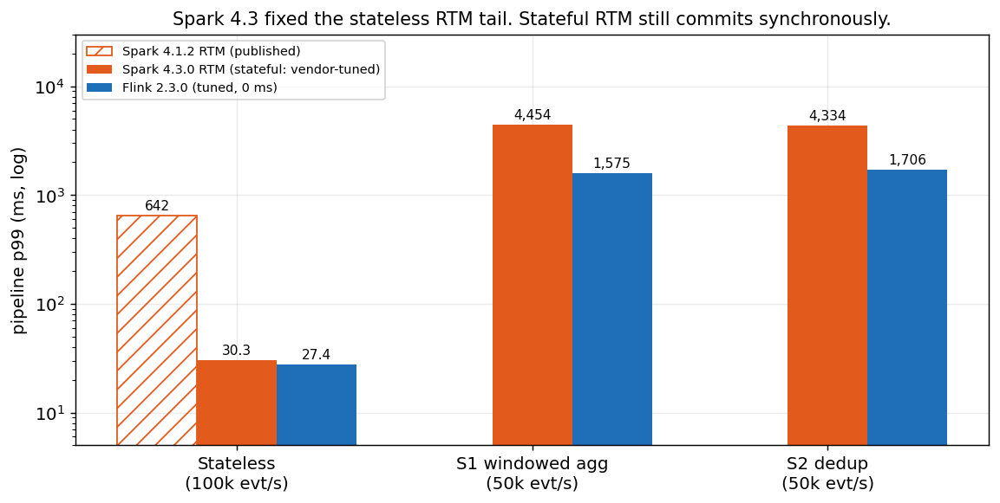

*Pipeline p99 on EKS. Stateless at 100k evt/s; stateful at 50k evt/s. The 4.1.2 bar is the
original post's published number.*

*All code, configs and raw data:
[github.com/fmorillo7694/spark-rtm-vs-flink](https://github.com/fmorillo7694/spark-rtm-vs-flink).*

---

## What this tests, and what it doesn't

This is **open-source Apache Spark 4.3.0** against **Apache Flink 2.3.0**. It is not Databricks
Runtime (DBR). Real-time Mode has been in OSS Spark since 4.1, but DBR ships extra RTM features
that OSS does not have. The one that matters here: **asynchronous state checkpointing is
DBR-only.** In OSS 4.3, a stateful RTM query commits its state synchronously at every batch
boundary. If you run DBR, your stateful numbers may look different, and this post does not
measure them.

### How it was measured

- **Engines:** Spark 4.3.0 and Flink 2.3.0, reading from and writing to Kafka 4.1 (Strimzi,
  3 brokers, RF 3, 6 partitions), fed by one shared Python datagen. Same harness as the
  original post.
- **Hardware:** 6 × m5.2xlarge on EKS 1.36. Two nodes are dedicated to the engine under test,
  one worker per node; Kafka, the producers and the consumer run on the other four.
- **Resources per engine:** one coordinator pod (1 core / 2 GB) plus two worker pods (3 cores /
  6 GB each), identical for Spark and Flink. Parallelism 6.
- **Checkpoints:** durable, to S3, every 60 s (Spark RTM trigger 60 s = Flink checkpoint
  interval 60 s).
- **Latency:** every output record carries the producer's `ts` and a per-row `out_ts`, so
  **pipeline latency = `out_ts − ts`**.
- **Duration and rate:** each run measures 30 minutes after a 60 s warm-up; stateless at
  100k evt/s, stateful at 50k evt/s. Each number is a geomean across runs, with the min-max
  range in brackets where spread matters.
- **Measured with 5-minute windows** (same harness, rates and resources): the Spark 1 ms flush
  arm, the async-progress-off control, the checkpoint-interval sweep, recovery, the smaller
  results, S4 at 100k evt/s and the S5 joins. Scaling uses its own ~40-minute load profile.

---

## Stateless vs stateful, in one paragraph

A **stateless** job looks at each record on its own: parse, filter, enrich, write. A crash only
means re-reading some input. A **stateful** job remembers: a running count per user, the set of
event IDs already seen, an open session waiting for a timeout. That state has to survive a
crash, so the engine checkpoints it to durable storage and restores it consistently with the
input offsets. That is where the two engines differ most. Flink snapshots state asynchronously,
in the background, while records keep flowing. OSS Spark RTM commits state synchronously at the
end of each long-running batch, and records wait while it does.

---

## Part 1: stateless, on 4.3 / 2.3

Same pipeline as before (filter, compute, uppercase, stamp, write to Kafka), same EKS setup,
~100k events/s in, ~33k/s out.

Stateless EKS, geomean across runs (p99 min-max in brackets).

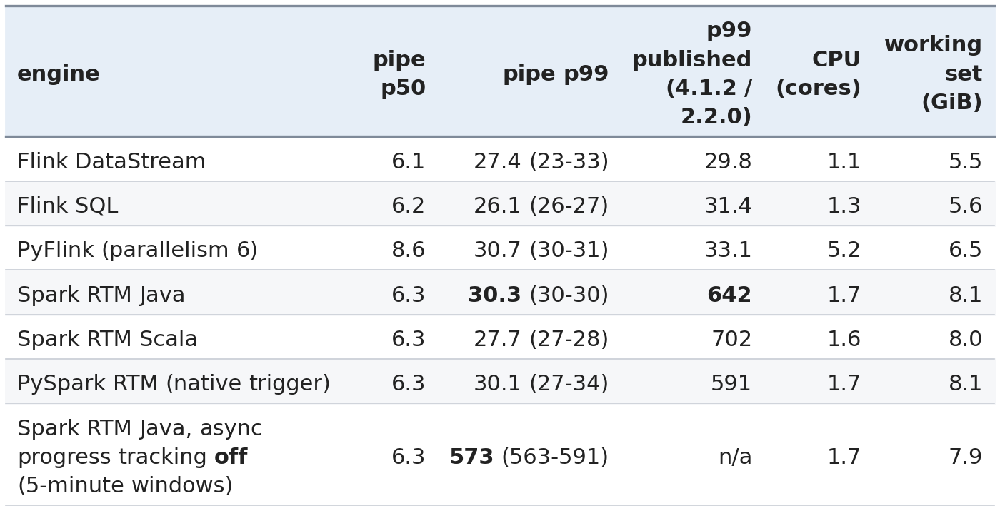

*ms unless noted. CPU and working set are the engine pods summed, from kubelet cAdvisor. The
async-off row used a higher-overhead consumer image, which plausibly explains most of a uniform
~30% drop against the 30-minute rows. The comparison is like-for-like within the 30-minute
rows.*

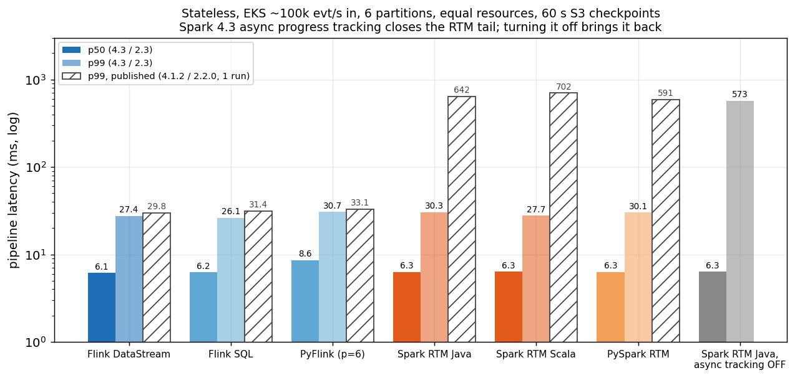

*Hatched bars are the published 4.1.2 / 2.2.0 numbers.*

**RTM's p99 went from 642 ms to 30.3 ms.** The cause is a 4.3 change: RTM now enables
**asynchronous progress tracking** by default
([SPARK-58131](https://issues.apache.org/jira/browse/SPARK-58131), listed in the
[4.3.0 release notes](https://spark.apache.org/releases/spark-release-4-3-0.html)). Offset and
commit-log writes move off the data path onto a single background `async-log-write` thread. I
confirmed it in every run: that thread is in the driver's jstack, the query runs as
`AsyncProgressTrackingMicroBatchExecution`, and the commit log entries have the async format.

The control arm settles the cause. Same job, same cluster, with
`asyncProgressTrackingEnabled=false`: **p99 573 ms**, right back where 4.1.2 was. So the old
tail really was the synchronous commit, and 4.3 really did fix it.

**What's left of the gap: at the tail, roughly nothing.** Flink DataStream's p99 is 27.4 ms,
Spark RTM Java's 30.3 ms, and the ranges overlap. Call it a tie. Flink still uses less memory
(5.5 vs 8.1 GiB working set; JVM heap peak 3.3 vs 6.3 GiB) at lower CPU (1.1 vs 1.7 cores).
Java, Scala and PySpark RTM medians are identical; their tails (28-30 ms) overlap. PySpark RTM
now has a native `trigger(realTime=...)`; the py4j bridge from the original post is no longer
needed.

### Defaults vs tuned, for stateless

For stateless, defaults and tuned are the same job. The two latency knobs I use below (Spark's
streaming-shuffle flush, Flink's buffer timeout) only act on network exchanges between
operators. The stateless pipeline has none: Flink chains source → map → sink into one task, and
Spark's RTM plan has no shuffle. Flink's stateless numbers use the 0 ms buffer timeout; I have
not run a 100 ms control to prove it's a no-op.

---

## Part 2: stateful

### What RTM 4.3 can and can't do

I checked the [4.3.0 RTM guide](https://spark.apache.org/docs/4.3.0/streaming/real-time-mode.html)
and the operator allowlist compiled into `spark-sql_2.13-4.3.0.jar`.

RTM 4.3 supports `dropDuplicates` with a watermark, streaming aggregations (including
`window()`, update mode only), Java / Scala `transformWithState` with processing-time timers, and
broadcast stream-static joins. Stream-stream joins, session windows and PySpark
`transformWithState` are out; the
[feature gaps](#what-rtm-cant-do-yet-feature-gaps) section has the full list.

That leaves enough for three head-to-head workloads.

### The workloads

All at **50k events/s**. At 100k, stateful Spark RTM saturated all 6 cores and Flink only just
kept up, so the comparison would measure backlog, not latency. 1M user keys, RocksDB state on
both engines, 5 s watermark, S3 checkpoints every 60 s.

- **S1, windowed aggregation:** count, sum and max per user per 10 s tumbling window. RTM only
  allows update output mode, so Spark emits the running result on every input row. The Flink arm
  does the same with a `KeyedProcessFunction`, so both produce the same stream of updates.
- **S2, dedup on `event_id`:** 10% of events are re-sent 0-3 s later. Both engines dedup in
  event time with a 5 s watermark, so both forget an id at the same point and drop the same late
  copies.
- **S3, sessions with timers:** per-user session state machine with 4 value states and a
  processing-time timeout. Spark: Java `transformWithState`. Flink: `KeyedProcessFunction`. The
  timeout is processing time on both because RTM holds its watermark fixed for a whole batch, so
  event-time timers would only fire at batch boundaries (every 60 s here).

### Both at defaults, both tuned

Each engine has one knob that sets the stateful median, because each workload has a network
exchange (the `keyBy` / shuffle into the stateful operator):

- **Spark:** `spark.shuffle.streaming.networkBufferMaxWaitTimeMs`, new in 4.3: how long a
  partly-filled streaming-shuffle buffer waits before it's sent to the state task. **Default
  50 ms, tuned 1 ms.**
- **Flink:** `execution.buffer-timeout`. **Default 100 ms, tuned 0 ms** (flush per record).

A third Spark arm is **vendor-tuned**: the settings from Databricks' latency benchmark repo
([databricks-solutions/latency-benchmarks](https://github.com/databricks-solutions/latency-benchmarks))
that exist in OSS 4.3. That's a 10 ms shuffle flush and
`spark.sql.streaming.stateStore.rocksdb.trackTotalNumberOfRows=false`. The repo's other big
setting, async state checkpointing, is DBR-only.

Stateful EKS, 50k evt/s: pipeline p50 / p99 in ms, geomean across runs.

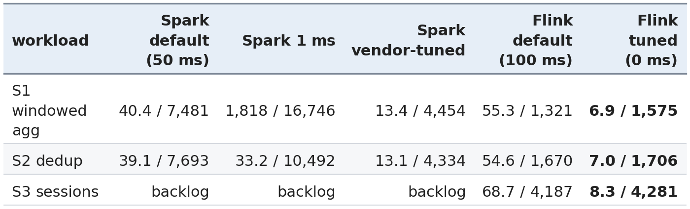

*The Spark 1 ms column was measured with 5-minute windows. On S3, Spark falls behind, so its
latency is a backlog, not a latency (see point 4).*

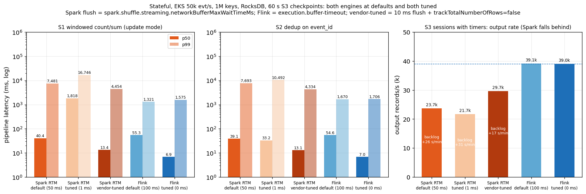

**1. Tuned Flink wins every stateful workload**, at the median and at the tail. Against the best
Spark arm (vendor-tuned), Flink's p50 is ~1.9x lower (6.9 vs 13.4 ms on S1, 7.0 vs 13.1 ms on S2)
and its p99 2.5-2.8x lower (1.6 vs 4.5 s on S1, 1.7 vs 4.3 s on S2).

**2. At defaults, the median is a coin toss.** Spark's 50 ms flush beats Flink's 100 ms buffer
timeout at the median (40 vs 55 ms on S1, 39 vs 55 ms on S2). The flush timer sets the median on
both engines. The tail doesn't care about it: Spark's default p99 is 7.5-7.7 s, Flink's
1.3-1.7 s.

**3. The "obvious" Spark tuning never helps the tail.** I expected 1 ms to do for Spark what
0 ms does for Flink. At 50k it doesn't.
On S1 it backfires: p50 1.8 s and p99 16.7 s, far worse than the 50 ms default. On S2 it helps
the median (33 ms vs 39 ms) and hurts the tail (p99 10.5 s, ~1.4x the default's). On both it's
CPU-bound: the flood of tiny shuffle messages takes ~5.9 cores, and the executors spend 93-94%
of CFS periods throttled at their 3-core limit (12-17% at 50 ms). The vendor-tuned 10 ms flush
is the best Spark arm on every metric, and the only one I'd call tuned.

**4. Spark can't sustain S3 at 50k evt/s.** `transformWithState` with a timer re-armed on every
event, 4 value states and 1M keys saturates all 6 Spark cores (94-96% throttled). Output falls
to 23.7k records/s (0.61x Flink's), and the backlog grows by 26 s of lag every minute. Batches
that should take 60 s stretched to about five minutes. The vendor settings help a little (29.7k
records/s, 0.76x, backlog +17 s/min), not enough. Flink keeps up at 39.0k records/s with an
8.3 ms p50. This is a throughput limit of OSS RTM's stateful path on this hardware, not a
latency number.

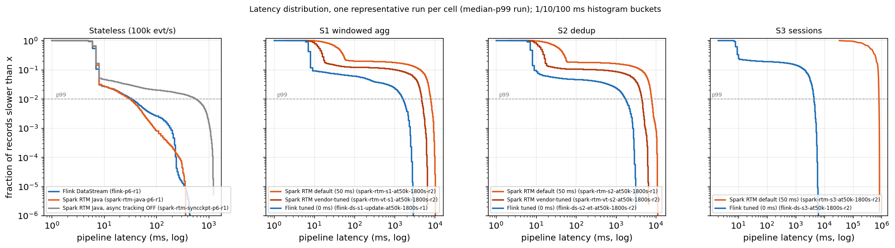

*Representative run = the run with the median p99 of its cell. Histogram buckets are 1/10/100 ms
lower bounds.*

On S1 and S2, about 91% of Flink records finish in under 10 ms. The rest form a shoulder that
runs out to ~2-3 s, all of it around checkpoints. Spark's curve is flat out to seconds for
9-18% of records: that's everything that queued behind a batch boundary.

### Why the stateful tail is seconds: the synchronous commit

Stateless RTM got async progress tracking. **Stateful RTM did not**: OSS 4.3 doesn't support it
with state, and every stateful run confirms it (no `async-log-write` thread, synchronous
`CommitLog`). At each 60 s batch boundary the long-running tasks finish, the state store commits
to S3, the driver commits offsets, and the next batch launches. Commit-to-commit is about 67 s
for a 60 s trigger (median overrun 7 s on S1 and S2, up to 10 s), so each boundary stalls the
pipeline for ~7 s. With 50k evt/s arriving, that's ~300k records queued per boundary, and
draining them takes tens of seconds. That's why Spark's p99 "away from the boundary" is as high
as right at it.

Flink isn't free either. Its S1/S2 checkpoints take ~3.0-3.3 s end to end (aligned barriers;
~134-155 MiB of RocksDB state, ~61-72 MiB uploaded per incremental checkpoint), and its p99 sits
at checkpoints too. The difference is that records keep flowing while Flink uploads.

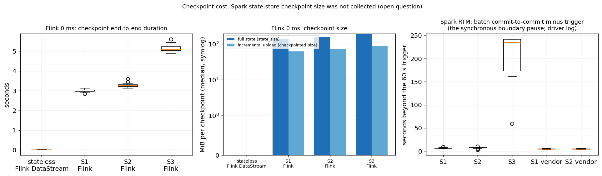

*Flink: per-checkpoint end-to-end duration and size from the REST checkpoint history. Spark:
commit-to-commit time minus the 60 s trigger, from the driver log.*

Vendor tuning shrinks Spark's median boundary pause from 7 s to 4 s, which is most of its p99
improvement. Flink has more tools for this tail (changelog backend, unaligned checkpoints, ForSt); I left them off
for a Part 2 tuning post.

### The checkpoint interval is a trade-off on Spark, not on Flink

If the tail is the boundary pause, a longer trigger should mean fewer pauses. It does, but each
pause has more to catch up. Pipeline p50 / p99 (ms) vs checkpoint interval (Flink) = trigger
(Spark), Spark at default flush, Flink at 0 ms:

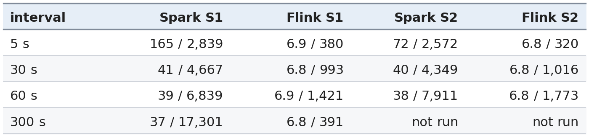

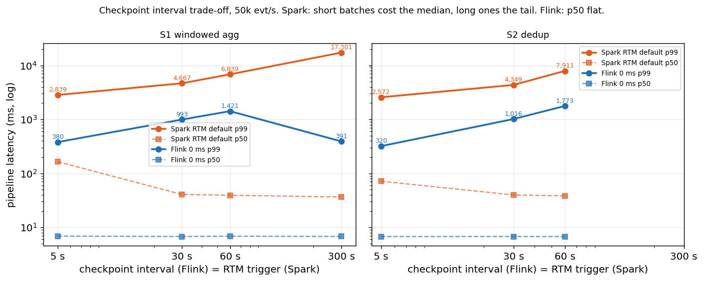

On Spark, a 5 s trigger cuts the p99 to ~2.8 s but quadruples the median, because batches
restart every 5 s. A 300 s trigger keeps the median but pushes p99 to 17 s. No setting gets
both. Flink's median doesn't move at any interval, and its p99 tracks how many checkpoints land
in the measurement, not the interval length. This sweep is its own series, so its 60 s row
differs slightly from the 2x2 table.

### Recovery: kill a worker mid-stream

At steady state on S1, I deleted one worker pod (a Spark executor or a Flink TaskManager) and
let the engine recover from the last checkpoint.

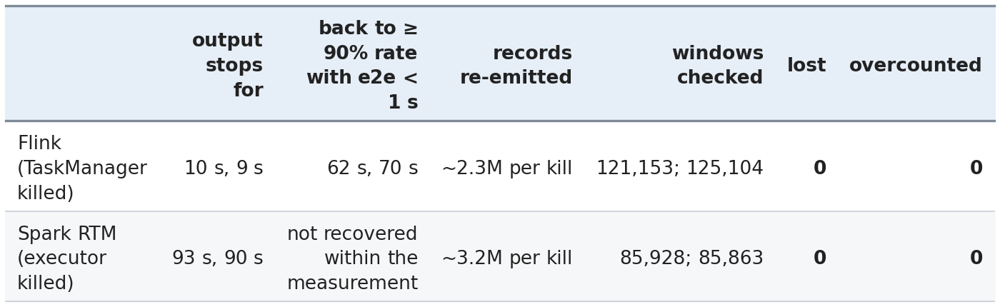

*Re-emitted = output records minus input records.*

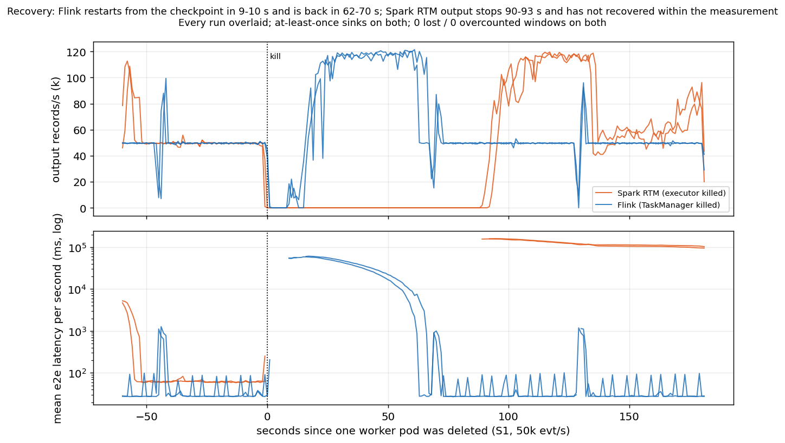

Flink restarts from the last checkpoint within 9-10 s, replays up to 60 s of input (the ~2.3M
re-emitted updates on an at-least-once sink), and is back to full rate with sub-second latency in
62-70 s. Spark's output stops for 90-93 s, and when it resumes it is still draining: within the
measurement it didn't get back to the input rate with e2e under 1 s. I haven't profiled where
Spark's 90 s goes (executor re-request, batch restart, state reload from S3).

**Neither engine lost or double-counted anything.** Checked against the producers' ground truth,
every settled (user, window) pair was right: 0 lost, 0 overcounted. Both restore state exactly
once; the duplicates are in the output, from the at-least-once Kafka sinks, so a downstream
consumer must be idempotent. In the original post's stateless test, both engines recovered in ~20 s. State is
what makes recovery expensive.

### Smaller results

- **Hot keys** (10% of events on 10 users, S1): no measurable effect on either engine
  (Spark 37 / 6,289 ms, Flink 6.8 / 1,243 ms).
- **Final-result windows:** Flink's window operator emits once per window, at window end plus
  the 5 s watermark (p50 ~10 s after the window's newest row). Spark RTM has no final-only
  output; micro-batch Spark S1 gives p50 3.6 s.
- **Exactly-once:** Flink's transactional Kafka sink costs nothing in processing (p50 6.9 ms)
  but records only become visible at checkpoint commit (read_committed e2e p50 ~44 s at a 60 s
  interval). RTM has no exactly-once sink, so there's no Spark counterpart.

---

## Part 3: joins

Only one of the two joins is a head-to-head, because OSS RTM 4.3 supports only one kind.

### S4: stream-static enrichment (RTM vs Flink)

Every event is joined on `user_id` against a 980,000-row reference table, read once at start
from a compacted Kafka topic; 2% of users have no row and are dropped (inner join). Spark RTM
uses `events.join(broadcast(ref), "user_id")`. Flink loads the table into an in-memory map in
`open()` on each TaskManager, which matches Spark's broadcast: one copy per worker, not in
checkpointed state, no shuffle. Neither job has a network exchange, so the flush knobs don't
apply, and the vendor-tuned Spark settings change nothing here (p99 287 ms, 279-296).

S4 at 50k evt/s, geomean across runs (p99 min-max in brackets).

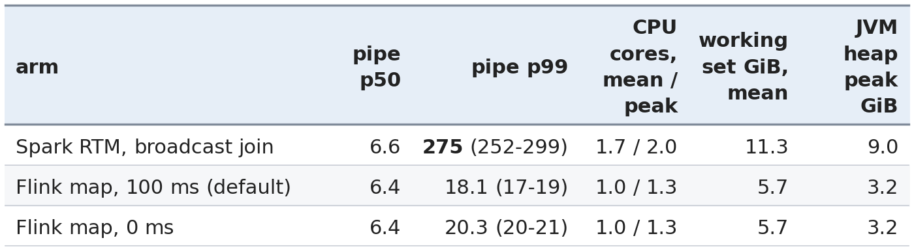

*ms unless noted. At 100k evt/s (5-minute windows) the picture is the same: p50 ~6 ms on both,
Spark p99 574 ms, Flink 18-27 ms.*

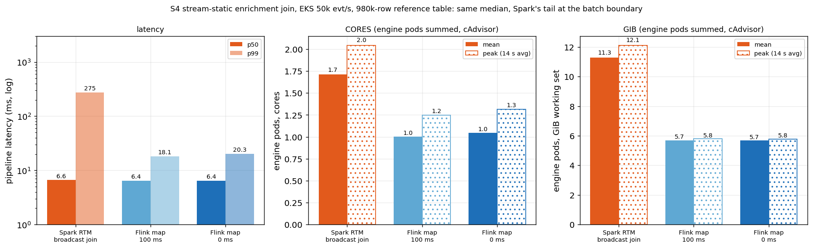

The median is a tie at ~6.5 ms. The tail is **~13.5x** (275 ms vs 20.3 ms at Flink's 0 ms, 15x
vs its 100 ms default). In a local smoke, Spark's slow records all fell at the RTM batch boundary (I haven't
measured that separately on EKS). It's the pre-4.3 stateless pattern, only smaller: no state to
commit, but the boundary still costs. Spark uses ~1.7x the CPU (1.7 vs
1.0 cores) and 2.0x the working set (11.3 vs 5.7 GiB; the table lives on the heap, 9.0 vs 3.2 GiB
peak).

**Correctness.** On identical input (93,248,434 events) Spark, vendor-tuned Spark and Flink all
emitted 91,382,100-91,382,101 joined records. The load must start only after the driver logs the
started query; without that gate, one Spark run came out 302,229 records short, because Spark
resolves `startingOffsets=latest` only when the query starts.

### S5: stream-stream interval join (what leaving RTM costs)

Orders joined to payments on `order_id` where the payment arrives within 10 s of the order. OSS
RTM 4.3 rejects stream-stream joins (`OPERATOR_OR_SINK_NOT_IN_ALLOWLIST`), so the Spark side runs
**micro-batch**. This measures what you give up by leaving RTM for this workload, not RTM vs
Flink. Spark: watermarked join with a time-range condition. Flink:
`keyBy(order_id).intervalJoin(...).between(0, 10 s)`.

S5 runs below saturation: `S5_RATE=1000` per producer pod (~8k orders/s plus ~6.8k payments/s,
~15k records/s), and one step up at 2000 per pod (~30k records/s).

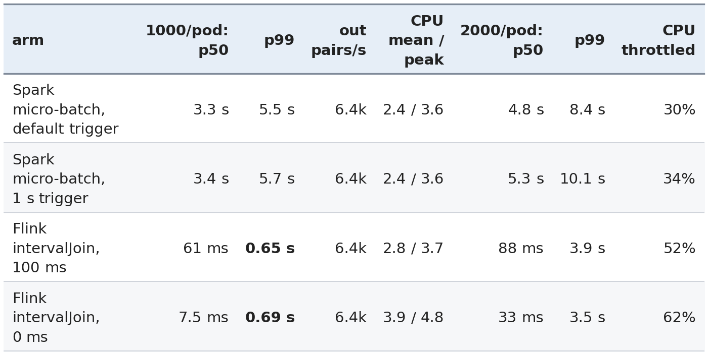

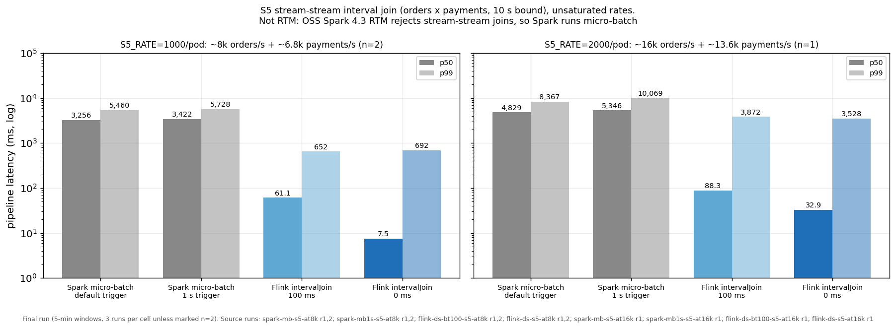

- **Below saturation, Flink's interval join wins at the median and the tail.** At ~15k
  records/s it is 7.5-61 ms at p50 and 0.65-0.69 s at p99, against 3.3-3.4 s and 5.5-5.7 s for
  Spark micro-batch. All four arms emit exactly the same pairs for the same input (2,432,233).
- **Spark's median is the batch:** a state-store commit per batch sets a seconds-scale floor,
  and the 1 s trigger doesn't lower it.
- **At 2000/pod Flink is near its limit** (p99 3.5-3.9 s, workers 52-62% throttled), still
  ~2-3x lower than Spark micro-batch's 8.4-10.1 s.
- **At ~50k records/s Spark's tail is better, but only because both engines saturate.** Flink
  emitted ~15.5-16.4k pairs/s against ~21.8k offered, its 11-27 s aligned checkpoints stalled
  the join, and its p99 reached 73-85 s, while Spark micro-batch kept pace with a p99 of ~17 s.
  That is a saturation result, not a latency head-to-head.

---

## Scaling under changing load

Real traffic moves, so I stepped S1 from **50k to 100k and back to 50k evt/s**. Engine nodes (m5.2xlarge) were managed by Cluster
Autoscaler, 1 to 5 nodes, with the same 3 CPU / 6 GiB workers as elsewhere. Topics had 24
partitions, so there was room to scale.

Flink ran as a static peak (parallelism 12, 4 TaskManagers), under its operator autoscaler
(starts at parallelism 6, vertices allowed 3-12, adaptive scheduler), and under Reactive Mode
with a Kubernetes HPA adding or removing TaskManagers on CPU (2-4). Spark RTM ran as a static
peak (4 executors) and with a manual restart at each step (2 or 4 executors, same checkpoint).
**Spark micro-batch + dynamic allocation** (1-4 executors) is not RTM; it is the Spark option
that does scale.

Phases 1/2/3 = 50k/100k/50k. Node-hours are relative to the same engine's static-peak arm.

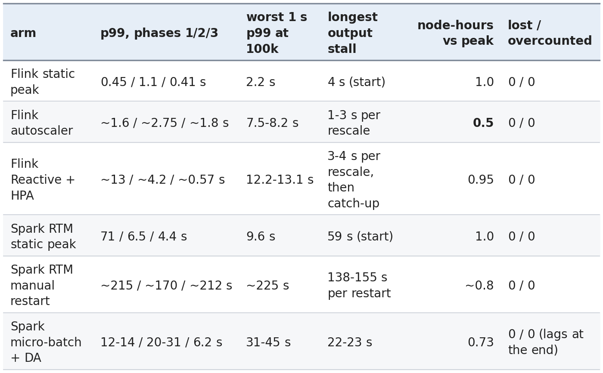

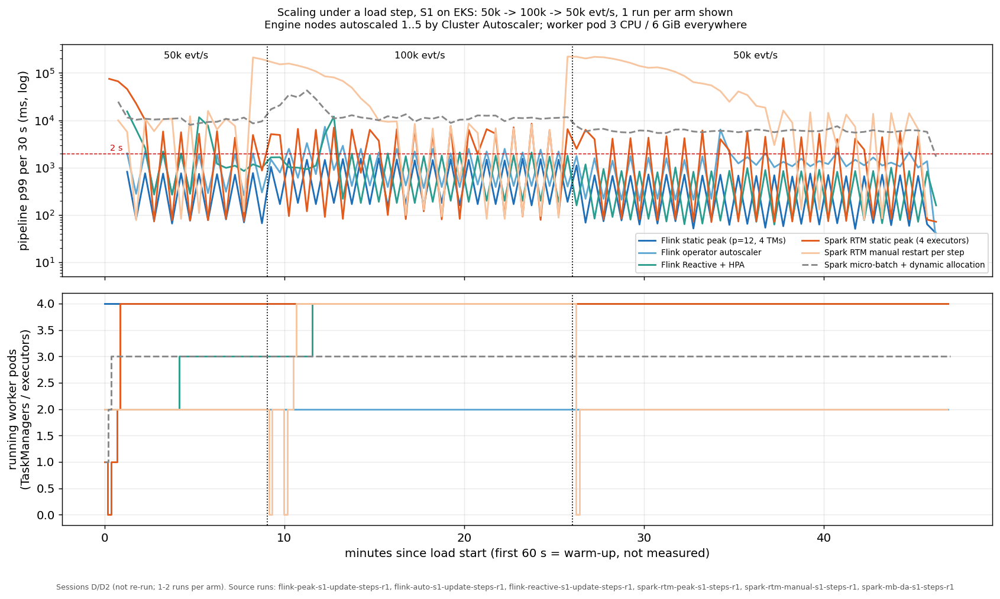

*p99 per 30 s and running worker pods.*

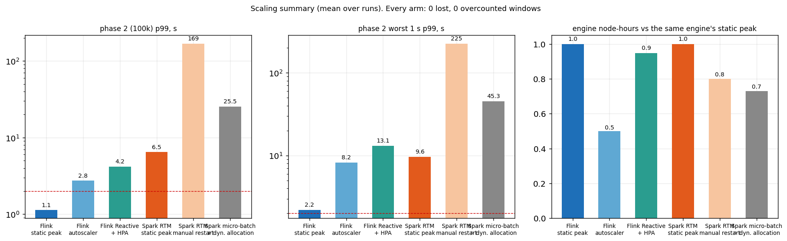

**Correctness held everywhere.** Every arm, including every restart and rescale, had 0 lost and 0
overcounted windows (a 1% user sample, ~1.3M settled windows per load profile). What changes is
latency, stalls and cost.

**Flink static peak is the only arm that kept p99 under 2 s through the step** (1.1 s at 100k).
It costs twice the node-hours of the autoscaler arm.

**The Flink autoscaler scaled down, even at 100k.** It never added a TaskManager. It moved the
source from parallelism 6 to 3 and the window operator from 6 to 4, kept 2 engine nodes, and used
**half the node-hours**. The cost was latency: p99 ~2.75 s at 100k with 7-8 s spikes. It sizes by
busy time, not latency. It estimated the window vertex could handle ~130-140k records/s at
parallelism 6 (its report: "Processing capacity 139837 -> 93225, target data rate 49741" for
6 -> 4), so by its own model scaling down was right. It doesn't model checkpoint stalls: at
parallelism 3-4 each checkpoint takes 3.1 s on average vs 2.0 s at 12, which is the 7-8 s spikes.
I shortened its default windows (the default scale-down interval is **1 hour**) to 2 min / 4 min
/ 6 min, so it is more reactive than a default deployment. Each in-place rescale stalled output
for 1-3 s.

It does scale up from a different start. Its estimate was learned during the 50k phase. Started
directly at 100k (the scale-in profile below), it scaled up within 8.8 min (sources 6 -> 12,
window 6 -> 8). If you have a p99 SLO, keep a static floor or a lower utilisation target under it.

**Flink Reactive + HPA works, but every rescale is a restart.** The job went
6 -> 9 -> 12 as the HPA added TaskManagers (CPU above its 70% target). Each step restarts the job
from the last checkpoint: a **10-20 s p99 spike** and a catch-up. Once at 12 it ran phase 3 at **~0.57 s p99**,
the best of any autoscaled arm. But **it never scaled back in** on this profile, so net it used
**~0.95x the node-hours of static peak, with worse latency in the first two phases.**

**Scale-in (100k -> 25k).** A second profile starts at 100k and drops to 25k.

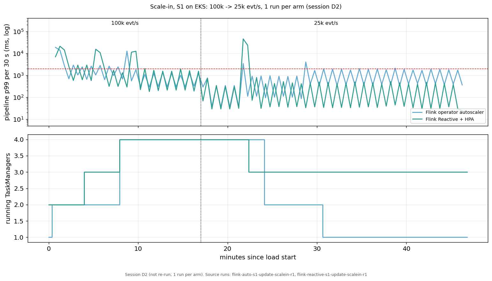

*p99 per 30 s and running TaskManagers.*

- **The operator autoscaler scales in cleanly.** It stepped down twice (to 6 at +4.9 min, to 3 at
  +11.9 min), each an in-place rescale with a short spike, and settled at a p99 of **1.45 s** at
  25k on one TaskManager (3.1 engine nodes on average).
- **Reactive scaled in one step, and that step was the worst event measured.** The HPA removed
  one TaskManager (4 -> 3) at +5.4 min. The restart to parallelism 9 pushed the 25k phase to
  **p99 29.7 s, with a 46 s spike, and took ~6 min to recover.** Removing capacity costs a full
  restart while the job is losing slots at the same time.

**Spark RTM can't autoscale.** Stateful RTM rejects dynamic allocation at runtime. The query
fails in `org.apache.spark.scheduler.DAGScheduler` (spark-core 4.3.0) with *"Dynamic allocation
is not supported for a job that uses a pipelined shuffle dependency"*. Stateless RTM isn't blocked by that check, but it maps Kafka partitions 1:1 to long-running
tasks, so extra executors get no work. That leaves two options:

- **Static peak:** with all 4 executors up it carried 100k at p99 6.5 s, but every 60 s batch
  boundary still spiked to 2-14 s, so it never held p99 under 2 s. Its phase 1 (71 s p99, 59 s stall) belongs to cluster start-up,
  not RTM; on the fixed 2-node shape, S1 p99 is ~7.5 s at 50k.
- **Manual restart at each step:** each stop-resubmit-start took **25-320 s**, and the backlog
  took 5-10 minutes to drain at a p99 of ~200 s. Restarting to scale was far more disruptive than
  the load step itself, and saved ~20% of node-hours.

**Spark micro-batch with dynamic allocation scales, but didn't keep up.** 2 executors went to 3,
never 4, and at the end of the measurement **about 15% of the input (27-28M records) was still
unprocessed**. The settled windows were all correct, so that's lag, not loss. Its 0.73x
node-hours mostly reflects not finishing the work.

Node-hours are estimates rebuilt from logs (10 s node samples), not billing data. This is S1
only, on two load profiles.

---

## Resources and cost

Latency is half the story. The other half is what each engine burns to get it.

**How to read these numbers.** An in-cluster sampler scrapes the kubelet's cAdvisor endpoint
every 2 s per engine container and reads JVM heap every 10 s. The kubelet refreshes stats only
about every 14 s, so CPU "peak" is the highest ~14 s average. Numbers are usage, not limits (same
requests and limits for both engines), cover engine pods only, and "per 10k events/s" divides by
the input rate. Memory is JVM-sized, so it reflects configuration as much as need.

Mean over runs, engine pods summed.

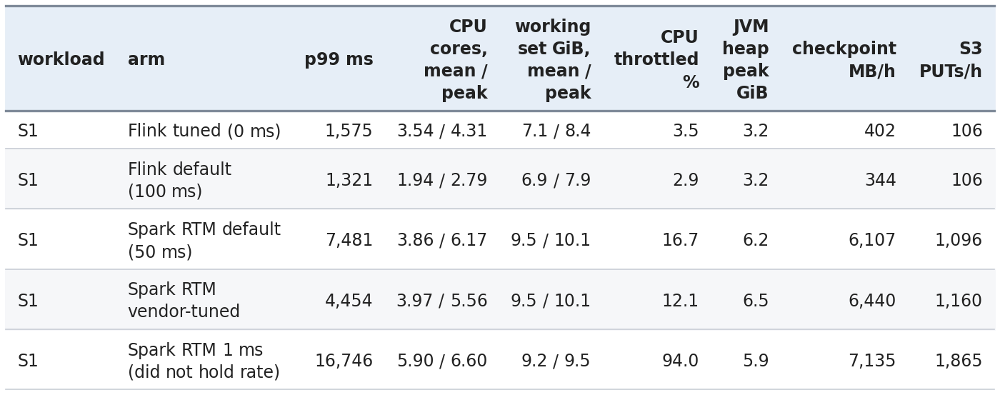

*S2 follows the same pattern. Stateless: Flink 1.06 cores, Spark 1.74. Spark on S3 (did not hold
rate) is pinned at 94-96% throttled.*

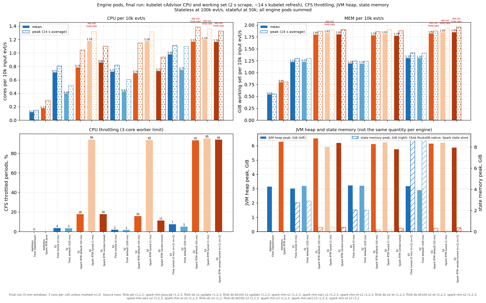

- **Mean CPU is close; peaks and throttling are not.** On S1/S2, tuned Flink and default Spark
  use about the same average CPU (3.4-3.9 cores, 0.67-0.77 per 10k evt/s). But Spark's peak is
  31-70% above its mean (4.7-6.2 cores), against 22-23% for Flink, and Spark's executors spend
  12-17% of CFS periods throttled at their 3-core limit, against 2-4% for Flink.
- **Flink's default is the cheap arm.** At a 100 ms buffer timeout, Flink uses ~45% less CPU
  than at 0 ms (1.9 vs 3.5 cores on S1, 2.0 vs 3.7 on S2) and still has a lower p99 (1.3-1.7 s)
  than every Spark arm (best: 4.3-4.5 s). The 0 ms setting buys the median and costs ~1.6-1.7
  cores at 50k.
- **Memory: Flink runs on 0.67-0.75 of Spark's working set** (6.2-7.1 vs 9.3-9.5 GiB on S1/S2,
  5.5 vs 8.1 GiB stateless), mostly heap: 3.2-3.4 GiB peak vs 6.2-6.5 GiB. Flink's RocksDB state
  lives off-heap, inside the same working set.
- **Spark writes 12-15x more checkpoint data.** On S1/S2 its checkpoint prefix grows by
  5.1-6.1 GB/h in ~1,100 objects/h at default settings; tuned Flink's by 0.40-0.44 GB/h in ~106.
  Flink uploads a median of 61-87 MiB per incremental checkpoint. Both are small next to compute:
  the S3 request cost is under $0.01 per hour for either engine.

The CPU timeline shows where Spark's bursts come from:

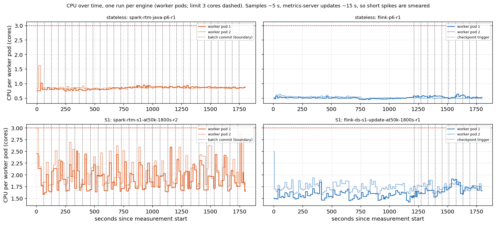

Stateful Spark is a sawtooth: CPU climbs 10-30 s after each batch boundary, as the executors
drain the ~300k records that queued during the synchronous commit. Stateful Flink is flat at this
sampling resolution. Stateless, both engines are flat.

### What it costs

**Equal hardware means equal dollars per hour.** Both engines ran on the same two m5.2xlarge
nodes at **$0.384/h each, on-demand, Linux, us-east-1** (per the
[AWS on-demand pricing page](https://aws.amazon.com/ec2/pricing/on-demand/)). At 50k evt/s that's
$0.768/h for 180M events/h, **$0.0043 per million events for both engines.** If you size the
cluster the way I did, the engine choice doesn't change the bill.

What changes is headroom. Pricing only the CPU each engine used, extrapolated linearly to a full
node (8 vCPU):

- **Stateless:** Flink needs ~0.4-0.6x the CPU of Spark RTM per event. Both are under $0.0004 per
  million events.
- **S1/S2:** at 0 ms, Flink uses about the same mean CPU per event as default Spark, and its
  extrapolated cost is 2-22% below vendor-tuned Spark, with a 2.5-2.8x lower p99. At its 100 ms
  default it's ~40-55% cheaper than any Spark arm that held the rate, *and* still has the lower
  p99.
- **S3:** only Flink's numbers exist. Spark didn't hold 50k evt/s on these 6 cores, so its cost
  per event there is undefined, not just higher.

**These per-node figures are extrapolations, not measurements.** No capacity probe was run, and
Spark's 1 ms arm shows scaling isn't always linear, so read them as an upper bound. The pool has
slack, but each pod doesn't: Spark executors are throttled 12-17% of the time even at default
settings, so free node CPU only helps if you resize the pods, which nothing here measured.

---

## What RTM can't do yet (feature gaps)

These are not head-to-head numbers, because only one engine can run them.

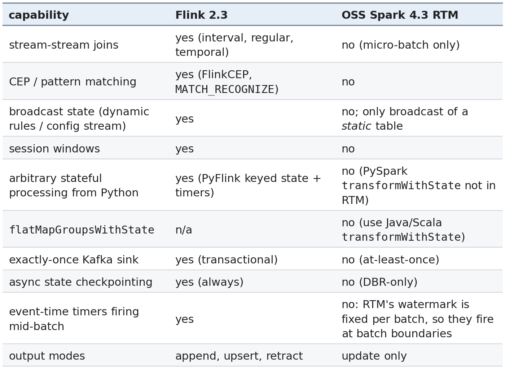

---

## Limits of this benchmark

- **Spread.** A Spark p99 depends on a handful of 60 s batch boundaries, so a single slow
  boundary can move it. The bracketed ranges show how far.
- **Capacity and cost per node are extrapolated,** not measured. CPU has ~14 s resolution, and
  S3 GET and LIST requests weren't counted.
- **Recovery is one scenario:** S1, one worker killed. Spark didn't get back to full rate within
  the measurement, so its recovery time is a lower bound.
- **S5's EKS correctness is cross-engine agreement,** not a ground-truth diff (all four arms
  emitted the same 2,432,233 pairs); a local replay is the ground truth.
- **One region, one instance type,** RocksDB on both sides, aligned checkpoints. The Flink tuning
  that targets checkpoint tails (changelog, unaligned, ForSt) is deferred to Part 2.
- **The Flink S2 tail is not fully explained.** The likely cause of its 1.7 s p99 is event-time
  cleanup timers firing in bursts on watermark advances, but I haven't profiled it.
- **Stateless placement differs from the original post.** Here the engines run on 2 dedicated
  nodes; the original post used one shared 6-node pool with Kafka and the producers. Keep that in
  mind when comparing against the published 4.1.2 / 2.2.0 numbers.
- **OSS only.** DBR's RTM (async state checkpointing, stream-stream joins) is a different product
  and is not tested.

---

## So, which one?

For **stateless** pipelines, Spark 4.3 RTM is now a real low-latency engine at production
durability: ~6 ms median, ~30 ms p99 with S3 checkpoints, from Java, Scala or Python. At the tail
it's roughly a tie with Flink (27.4 vs 30.3 ms), and Flink is still leaner on memory; the 20x gap
from the original post is gone. If you're on Spark and your job is stateless, RTM is a good
choice today.

For **stateful** pipelines, tuned Flink wins every workload I could run on both: about 1.9x lower
median and 2.5-2.8x lower p99 than the best-tuned OSS RTM, a recovery that's back in about a
minute while Spark's hadn't recovered within the measurement, and the timer-heavy session
workload that RTM can't sustain at 50k evt/s. The cause is one design choice: OSS stateful RTM
still commits synchronously. When that goes async in OSS, I'd expect stateful RTM to follow the
path stateless RTM just did, and I'll revisit this.

For **changing load** (S1, 50k -> 100k -> 50k), both engines kept state exact through every
rescale and restart, but only static Flink sized for the peak kept p99 under 2 s. Flink's
operator autoscaler halved the node-hours by scaling *down*, at ~2.75 s p99 with 7-8 s spikes;
started at 100k, it scaled up, and it scaled back in cleanly at 25k. Flink Reactive + HPA
restarts on every rescale (10-20 s spikes), and its one scale-in step was the worst event
measured (p99 29.7 s). OSS Spark RTM has no autoscaling path at all: stateful RTM rejects dynamic
allocation, and a manual restart stalls 25-320 s.

For **joins**, the stream-static enrichment RTM supports ties Flink at the median (~6.5 ms) but
carries a ~13.5x tail (275 vs 20 ms), ~1.7x the CPU and 2.0x the working set. For the
stream-stream join RTM doesn't support, Spark micro-batch is the fallback, and below saturation
Flink's interval join beats it at the median and the tail (p99 0.65-0.69 s vs 5.5-5.7 s).

And for the workloads RTM doesn't run yet (stream-stream joins, CEP, broadcast state, session
windows), Flink is the only option in this comparison.

---

## Appendix A: run it yourself

```bash
# EKS stateless p6 matrix (Spark 4.3.0 / Flink 2.3.0)
eks/04b_run_p6.sh <engine>
# EKS stateful matrix, in-cluster runner (one cluster per plan set F30A..F30D)
PLAN_SET=F30A BUDGET_S=34200 RUN_EST_S=1260 SELF_TEARDOWN=1 eks/stateful/deploy_runner.sh
# Tables and charts
python3 bench/analyze_final_run.py results/final30 --runs 2
python bench/make_post_charts.py    # -> post/charts/*.png + numbers.json
```

## Appendix B: reproduction

Cluster scripts, the in-cluster runner and the sampler are in
[the repo](https://github.com/fmorillo7694/spark-rtm-vs-flink) under `eks/`. Start with the
[README](https://github.com/fmorillo7694/spark-rtm-vs-flink/blob/main/README.md) for the
deploy-run-teardown steps. Every engine setting for every arm is in
[`STATEFUL_CONFIG.md`](https://github.com/fmorillo7694/spark-rtm-vs-flink/blob/main/STATEFUL_CONFIG.md),
and the per-cell summaries, raw data and cell list are in
[`results/final30/RESULTS.md`](https://github.com/fmorillo7694/spark-rtm-vs-flink/blob/main/results/final30/RESULTS.md).
