<!--
  Regenerate tables and charts: `bench/analyze_final_run.py`, then `bench/make_post_charts.py`
  -> post/charts/ (numbers.json holds every charted number).

  Medium upload: charts are in post/charts/, in order of appearance:
    00_hero.png  01_stateless_eks.png  02_stateful_2x2.png  03_latency_ccdf.png
    07_checkpoints.png  04_checkpoint_interval.png  05_recovery_timeline.png
    08_resources_per_10k.png  09_cpu_timeline.png
    10_s4_broadcast_join.png  11_s5_interval_join.png  12_scaling_timeline.png  13_scaling_summary.png
    14_scalein_timeline.png
-->

# Spark 4.3 Real-time Mode vs Flink 2.3: the tail got fixed, then I added state

*Six months ago I benchmarked Spark 4.1's new Real-time Mode against Flink. RTM tied Flink at
the median and lost by ~20x at the tail. Spark 4.3 is out, and it fixes that tail for stateless
jobs. It also lets RTM run stateful queries for the first time. So I re-ran the original
benchmark and then added three stateful workloads, plus joins. Short version: the stateless gap
is gone (the tails are now about even); the stateful gap is the new story.*

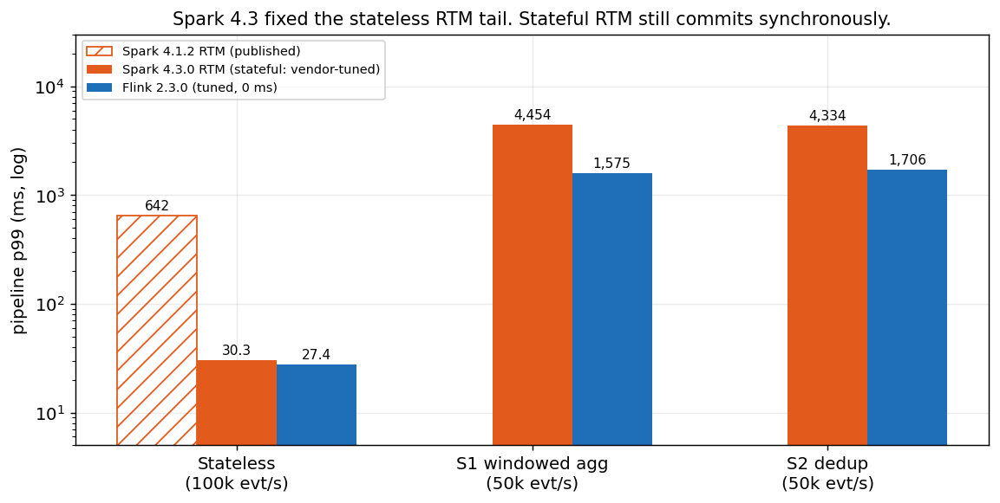

*Pipeline p99 on EKS. Stateless at 100k evt/s; stateful at 50k evt/s. The 4.1.2 bar is the
original post's published number.*

*All code, configs and raw per-run data:
[github.com/fmorillo7694/spark-rtm-vs-flink](https://github.com/fmorillo7694/spark-rtm-vs-flink)
(raw results under [`results/final30/`](https://github.com/fmorillo7694/spark-rtm-vs-flink/tree/main/results/final30),
summary in [`results/final30/RESULTS.md`](https://github.com/fmorillo7694/spark-rtm-vs-flink/blob/main/results/final30/RESULTS.md)).*

---

## What this tests, and what it doesn't

This is **open-source Apache Spark 4.3.0** (`apache/spark:4.3.0` images) against **Apache Flink
2.3.0**. It is not Databricks Runtime. Real-time Mode has been in OSS Spark since 4.1 (the
original post ran it on OSS 4.1.2), but Databricks ships extra RTM features in DBR that OSS does
not have. The one that matters most here: **asynchronous state checkpointing is DBR-only.** In
OSS 4.3, a stateful RTM query commits its state synchronously at every batch boundary. Keep that
in mind for everything stateful below. If you run DBR, your stateful numbers may look different,
and this post does not measure them.

### How it was measured

- **Engines:** Apache Spark 4.3.0 (`apache/spark:4.3.0`) and Apache Flink 2.3.0, reading from
  and writing to Kafka 4.1 (Strimzi, 3 brokers, RF 3, 6 partitions), fed by one shared Python
  datagen. Same harness as the original post.
- **Hardware:** 6 × m5.2xlarge on EKS 1.36. Two nodes are dedicated to the engine under test,
  one worker per node; Kafka, the producers and the consumer run on the other four.
- **Resources per engine:** one coordinator pod (1 core / 2 GB) plus two worker pods (3 cores /
  6 GB each), identical for Spark and Flink.
- **Parallelism:** 6.
- **Checkpoints:** durable, to S3, every 60 s (Spark RTM trigger 60 s = Flink checkpoint
  interval 60 s).
- **Latency:** every output record carries the producer's `ts` and a per-row `out_ts`, so
  **pipeline latency = `out_ts − ts`**.
- **Duration and rate:** each run measures 30 minutes after a 60 s warm-up; stateless at
  100k evt/s, stateful at 50k evt/s.
- **Aggregation:** each number is a geomean across repeated runs, with the min-max range in
  brackets where spread matters.
- **Measured with 5-minute windows** (same harness, rates and resources): the Spark 1 ms flush
  arm, the async-progress-off control, the checkpoint-interval sweep, recovery,
  the smaller results, S4 at 100k evt/s and the S5 joins. Scaling uses its own ~40-minute load
  profile.

---

## Stateless vs stateful, in one paragraph

A **stateless** job looks at each record on its own: parse, filter, enrich, write. Nothing it
does depends on records it saw earlier, so a crash only means re-reading some input. A
**stateful** job remembers: a running count per user, the set of event IDs already seen, an open
session waiting for a timeout. That memory (the *state*) has to survive a crash, so the engine
must checkpoint it to durable storage and restore it consistently with the input offsets. That
checkpoint is where the two engines differ most. Flink snapshots state asynchronously, in the
background, while records keep flowing. OSS Spark RTM commits state synchronously at the end of
each long-running batch, and records wait while it does.

---

## Part 1: stateless, on 4.3 / 2.3

Same pipeline as before (filter, compute, uppercase, stamp, write to Kafka), same EKS setup,
~100k events/s in, ~33k/s out.

Stateless EKS, geomean across runs (p99 min-max in brackets).

| engine | pipe p50 | pipe p99 | p99 published (4.1.2 / 2.2.0) | CPU (cores) | working set (GiB) |
|---|--:|--:|--:|--:|--:|
| Flink DataStream | 6.1 | 27.4 (23-33) | 29.8 | 1.1 | 5.5 |
| Flink SQL | 6.2 | 26.1 (26-27) | 31.4 | 1.3 | 5.6 |
| PyFlink (parallelism 6) | 8.6 | 30.7 (30-31) | 33.1 | 5.2 | 6.5 |
| Spark RTM Java | 6.3 | **30.3** (30-30) | **642** | 1.7 | 8.1 |
| Spark RTM Scala | 6.3 | 27.7 (27-28) | 702 | 1.6 | 8.0 |
| PySpark RTM (native trigger) | 6.3 | 30.1 (27-34) | 591 | 1.7 | 8.1 |
| Spark RTM Java, async progress tracking **off** (5-minute windows) | 6.3 | **573** (563-591) | n/a | 1.7 | 7.9 |

*ms unless noted. CPU and working set are the engine pods summed, mean over the measurement,
from kubelet cAdvisor. Absolute stateless p99s depend on the measurement consumer: the 30-minute
rows use a lower-overhead consumer image than the async-off control, which plausibly explains
most of a uniform ~30% drop against the 5-minute measurements. The comparison is like-for-like
within the 30-minute rows.*

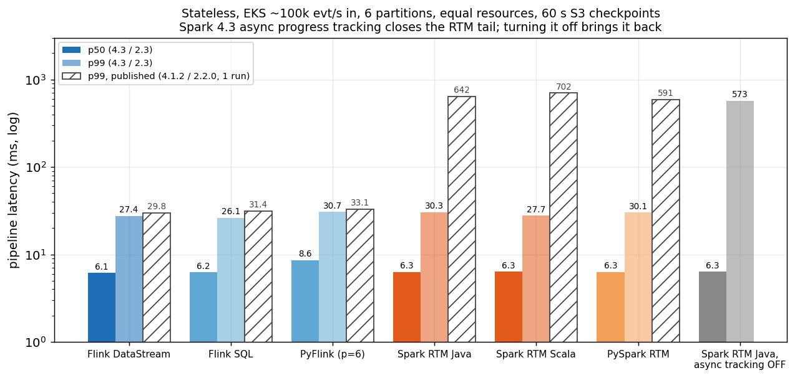

*Hatched bars are the published 4.1.2 / 2.2.0 numbers.*

**RTM's p99 went from 642 ms to 30.3 ms.** The cause is a 4.3 change: RTM now enables
**asynchronous progress tracking** by default ([SPARK-58131](https://issues.apache.org/jira/browse/SPARK-58131), listed in the
[4.3.0 release notes](https://spark.apache.org/releases/spark-release-4-3-0.html)). Offsets and commit-log writes move
off the data path onto a single background `async-log-write` thread. I confirmed it in every
run: that thread is in the driver's jstack, the query runs as
`AsyncProgressTrackingMicroBatchExecution`, and the commit log entries have the async format.

The control arm settles the cause. Same job, same cluster, with
`asyncProgressTrackingEnabled=false` (5-minute windows): **p99 573 ms**, right back where 4.1.2
was. So the old
tail really was the synchronous commit (the original post's diagnosis), and 4.3 really did fix
it.

**What's left of the gap: at the tail, roughly nothing.** Flink DataStream's p99 is 27.4 ms,
Spark RTM Java's 30.3 ms, and the run-to-run ranges overlap (Flink 23-33 ms, Spark 30 ms).
Call it a tie. Flink still uses less memory (5.5 vs 8.1 GiB working set; JVM heap peak 3.3 vs
6.3 GiB) at lower CPU (1.1 vs 1.7 cores). Java, Scala and PySpark RTM medians are identical;
their tails (28-30 ms) overlap. PySpark RTM now has a native `trigger(realTime=...)`; the py4j bridge
from the original post is no longer needed.

### Defaults vs tuned, for stateless

This is where the 2x2 (both engines at defaults, both tuned) collapses. The two latency knobs I
use below (Spark's streaming-shuffle flush, Flink's buffer timeout) only act on network exchanges
between operators. The stateless pipeline has none: Flink chains source → map → sink into one
task, and Spark's RTM plan has no shuffle. So for stateless, default and tuned should be the
same job. Flink's stateless numbers use the 0 ms buffer timeout; I have not run a 100 ms
control to prove it's a no-op.

---

## Part 2: stateful

### What RTM 4.3 can and can't do

Before benchmarking state, here's what OSS RTM 4.3 accepts. I checked the
[4.3.0 RTM guide](https://spark.apache.org/docs/4.3.0/streaming/real-time-mode.html) and the
operator allowlist compiled into `spark-sql_2.13-4.3.0.jar`.

| supported in RTM 4.3 (DataFrame / SQL API) | not supported in RTM 4.3 |
|---|---|
| `dropDuplicates` with a watermark | stream-stream joins |
| streaming aggregations, including `window()` (update mode only) | `flatMapGroupsWithState` |
| Java / Scala `transformWithState`, with processing-time timers | session windows |
| broadcast stream-static joins | PySpark `transformWithState` |
| | `dropDuplicatesWithinWatermark` |
| | exactly-once Kafka sink (RTM is at-least-once) |
| | async state checkpointing (DBR-only) |

That leaves enough for three head-to-head workloads. Everything in the right-hand column is in
the feature-gap table further down.

### The workloads

All at **50k events/s** (not 100k: at 100k, stateful Spark RTM saturated all 6 cores and Flink
only just kept up, so the comparison would measure backlog, not latency). 1M user keys, RocksDB
state on both engines, 5 s watermark, durable S3 checkpoints every 60 s (RTM trigger 60 s = Flink
checkpoint interval 60 s).

- **S1, windowed aggregation:** count, sum and max per user per 10 s tumbling window. RTM only
  allows update output mode, so Spark emits the running result on every input row. The Flink arm
  does the same thing with a `KeyedProcessFunction` (`s1-update`), so both produce the same
  stream of updates.
- **S2, dedup on `event_id`:** 10% of events are re-sent 0-3 s later. Both engines dedup in
  event time with a 5 s watermark. Spark uses `withWatermark(...).dropDuplicates(...)`. Flink
  uses keyed state cleared by an event-time timer when the watermark passes the event, so both
  forget an id at the same point and both drop the same late copies.
- **S3, sessions with timers:** per-user session state machine with 4 value states and a
  processing-time timeout. Spark: Java `transformWithState`. Flink: `KeyedProcessFunction`. Same
  code path in both, verified by an exact local replay against ground truth. The timeout is
  processing time on both engines because RTM holds its watermark fixed for a whole batch, so
  event-time timers would only fire at batch boundaries (every 60 s here).

Every setting for every arm is in
[`STATEFUL_CONFIG.md`](https://github.com/fmorillo7694/spark-rtm-vs-flink/blob/main/STATEFUL_CONFIG.md).

### Both at defaults, both tuned

Each engine has one knob that sets the stateful median, because each workload has a network
exchange (the `keyBy` / shuffle into the stateful operator):

- **Spark:** `spark.shuffle.streaming.networkBufferMaxWaitTimeMs`, new in 4.3: how long a
  partly-filled streaming-shuffle buffer waits before it's sent to the state task. **Default
  50 ms, tuned 1 ms.**
- **Flink:** `execution.buffer-timeout`. **Default 100 ms, tuned 0 ms** (flush per record).

Plus a third Spark arm, **vendor-tuned**: the settings from Databricks' latency benchmark repo
([databricks-solutions/latency-benchmarks](https://github.com/databricks-solutions/latency-benchmarks)) that exist in OSS 4.3. That's a 10 ms shuffle flush and
`spark.sql.streaming.stateStore.rocksdb.trackTotalNumberOfRows=false`. The repo's other big
setting, async state checkpointing, is DBR-only, so it's not in this arm.

Stateful EKS, 50k evt/s: pipeline p50 / p99 in ms, geomean across runs.

| workload | Spark default (50 ms) | Spark 1 ms | Spark vendor-tuned | Flink default (100 ms) | Flink tuned (0 ms) |
|---|--:|--:|--:|--:|--:|
| S1 windowed agg | 40.4 / 7,481 | 1,818 / 16,746 | 13.4 / 4,454 | 55.3 / 1,321 | **6.9 / 1,575** |
| S2 dedup | 39.1 / 7,693 | 33.2 / 10,492 | 13.1 / 4,334 | 54.6 / 1,670 | **7.0 / 1,706** |
| S3 sessions | backlog | backlog | backlog | 68.7 / 4,187 | **8.3 / 4,281** |

*The Spark 1 ms column was measured with 5-minute windows. On S3, Spark falls behind, so its
latency is a backlog, not a latency (see point 4).*

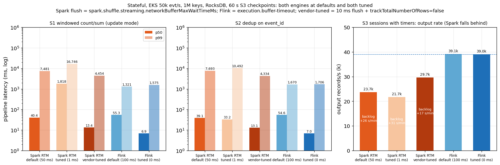

Four things fall out of this.

**1. Tuned Flink wins every stateful workload**, at the median and at the tail. Against the best
Spark arm (vendor-tuned), Flink's p50 is ~1.9x lower (6.9 vs 13.4 ms on S1, 7.0 vs 13.1 ms on S2)
and its p99 2.5-2.8x lower (1.6 vs 4.5 s on S1, 1.7 vs 4.3 s on S2).

**2. At defaults, the median is a coin toss.** Spark's 50 ms flush beats Flink's 100 ms buffer
timeout at the median (40 vs 55 ms on S1, 39 vs 55 ms on S2). The flush timer sets the median on
both engines. The tail doesn't care about the flush timer at all: Spark's default p99 is
7.5-7.7 s, Flink's 1.3-1.7 s.

**3. The "obvious" Spark tuning depends on the workload, and it never helps the tail.** I
expected 1 ms to do for Spark what 0 ms does for Flink. In a 3k evt/s local smoke it did (7 ms vs
Flink's 6 ms). At 50k it doesn't, in two different ways:

- **On S1 it backfires.** p50 1.8 s (1.2-2.7 s across runs) and p99 16.7 s, far worse than the
  50 ms default on both.
- **On S2 it helps the median and hurts the tail.** p50 33 ms, a little better than the default's
  39 ms, but p99 10.5 s (8.7-13.7 s), ~1.4x the default's.
- **On both it's CPU-bound.** The flood of tiny shuffle messages takes ~5.9 cores, and the
  executors spend 93-94% of CFS periods throttled at their 3-core limit (12-17% at 50 ms).

The vendor-tuned 10 ms flush is the best Spark arm on every metric, and it's the only one I'd
call tuned.

**4. Spark can't sustain S3 at 50k evt/s.** `transformWithState` with a timer re-armed on every
event, 4 value states and 1M keys saturates all 6 Spark cores (94-96% throttled). Output falls
to 23.7k records/s (0.61x Flink's), and the backlog grows by 26 s of lag every minute. Batches
that should take 60 s stretched to about five minutes (median overrun 235 s). The vendor settings
help a little (29.7k records/s, 0.76x, backlog +17 s/min), not enough. Flink keeps up at 39.0k
records/s with an 8.3 ms p50. Under a growing backlog a p50 only measures how long you measured,
so the 2x2 shows S3 as output rate. This is a throughput limit of OSS RTM's stateful path on this
hardware, not a latency number.

The latency distributions show where the time goes:

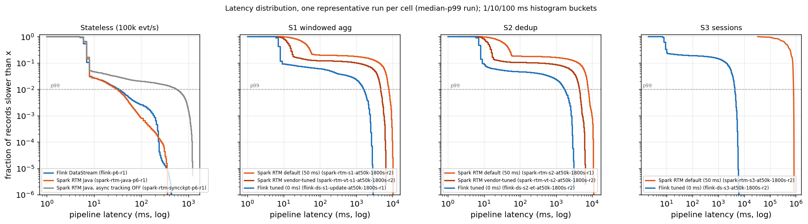

*Representative run = the run with the median p99 of its cell (the chart caption
names each one). Histogram buckets are 1/10/100 ms lower bounds.*

On S1 and S2, about 91% of Flink records finish in under 10 ms. The rest form a shoulder that
runs out to ~2-3 s, all of it around checkpoints. Spark's curve is flat out to seconds for
9-18% of records: that's everything that queued behind a batch boundary.

### Why the stateful tail is seconds: the synchronous commit

Stateless RTM got async progress tracking. **Stateful RTM did not**: OSS 4.3 doesn't support it
with state, and every stateful run confirms it (no `async-log-write` thread, synchronous
`CommitLog`). At each 60 s batch boundary the long-running tasks finish, the state store
commits to S3, the driver commits offsets, and the next batch launches. The driver log shows
how long that takes: commit-to-commit is about 67 s for a 60 s trigger (median overrun 7 s on
S1 and S2, up to 10 s), so each boundary stalls the pipeline for ~7 s. With 50k evt/s arriving, that's ~300k records queued per boundary,
and draining that backlog takes tens of seconds. That's why Spark's p99 "away from the boundary"
is as high as right at it.

Flink isn't free either. Its S1/S2 checkpoints take ~3.0-3.3 s end to end (aligned barriers;
~134-155 MiB of RocksDB state, ~61-72 MiB uploaded per incremental checkpoint), and its p99 sits
at checkpoints too. The difference
is that records keep flowing while Flink uploads.

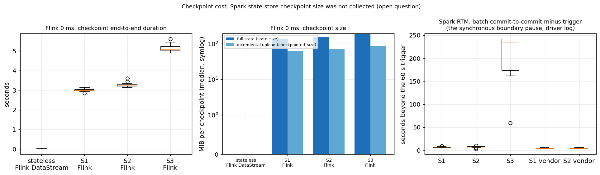

*Flink: per-checkpoint end-to-end duration and size from the REST checkpoint history (completed
checkpoints only; the REST history keeps the last 20 per job). Spark: commit-to-commit time minus
the 60 s trigger, from the driver log.
Spark's checkpoint size is in [Resources and cost](#resources-and-cost).*

The vendor-tuned settings shrink Spark's boundary pause from a median of 7 s to 4 s on S1
and S2, which is where most of its p99 improvement comes from.

Flink has a few more tools for exactly this tail: the changelog state backend, unaligned
checkpoints, and ForSt disaggregated state. I left all three off (both engines on RocksDB with
aligned checkpoints) and will cover them in a Part 2 tuning post.

### The checkpoint interval is a trade-off on Spark, not on Flink

If the tail is the boundary pause, a longer trigger should mean fewer pauses. It does, but each
pause has more to catch up:

Pipeline p50 / p99 (ms) vs checkpoint interval (Flink) = trigger (Spark).

| interval | Spark S1 | Flink S1 (0 ms) | Spark S2 | Flink S2 (0 ms) |
|---|--:|--:|--:|--:|
| 5 s | 165 / 2,839 | 6.9 / 380 | 72 / 2,572 | 6.8 / 320 |
| 30 s | 41 / 4,667 | 6.8 / 993 | 40 / 4,349 | 6.8 / 1,016 |
| 60 s | 39 / 6,839 | 6.9 / 1,421 | 38 / 7,911 | 6.8 / 1,773 |
| 300 s | 37 / 17,301 | 6.8 / 391 | not run | not run |

*Spark at default flush, Flink at 0 ms. The interval sweep was measured as its own series, so its
60 s row differs slightly from the 2x2 table above.*

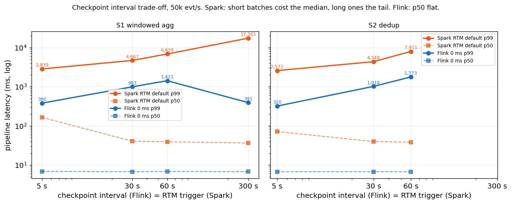

On Spark, a 5 s trigger cuts the p99 to ~2.8 s but quadruples the median, because batches
restart every 5 s. A 300 s trigger keeps the median but pushes p99 to 17 s. There's no
setting that gets both. Flink's median doesn't move at any interval. Its p99 tracks how many
checkpoints land in the measurement, not the interval length, so a 300 s interval gives the
lowest p99 of all (only two checkpoints measured). The 5 s Spark S1 median also varied a lot
across runs, so treat that cell as rough.

### Recovery: kill a worker mid-stream

Once the job was at steady state, I deleted one worker pod (a Spark executor or a Flink TaskManager) during S1
and let the operators recover from the last checkpoint.

S1 at 50k evt/s, ground truth captured for every run.

| | output stops for | back to ≥ 90% rate with e2e < 1 s | records re-emitted | windows checked | lost | overcounted |
|---|--:|--:|--:|--:|--:|--:|
| Flink (TaskManager killed) | 10 s, 9 s | 62 s, 70 s | ~2.3M per kill | 121,153; 125,104 | **0** | **0** |
| Spark RTM (executor killed) | 93 s, 90 s | not recovered within the measurement | ~3.2M per kill | 85,928; 85,863 | **0** | **0** |

*Re-emitted = output records minus input records.*

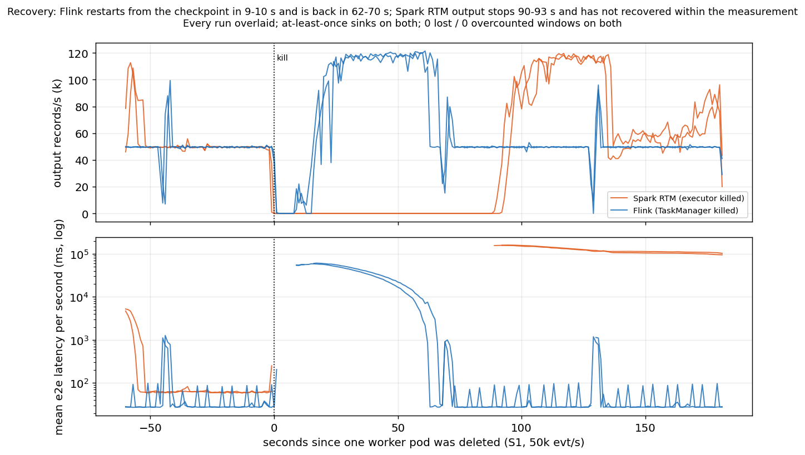

*Output rate and mean e2e latency per second around the kill, every run overlaid.*

Flink restarts the job from the last checkpoint within 9-10 s, replays up to 60 s of input
(that's the ~2.3M re-emitted updates on an at-least-once sink), and is back to full rate with
sub-second latency in 62-70 s. Spark's output stops for 90-93 s, and when it resumes it is still
draining: within the measurement it didn't get back to the input rate with e2e under 1 s. It
also re-emitted ~3.2M records per kill, so Spark's recovery is not
duplicate-free either. I haven't profiled where Spark's 90 s goes (executor re-request, batch
restart, state reload from S3).

**Neither engine lost or double-counted anything.** With the producers' ground truth captured,
every settled (user, window) pair the run touched checked out: 0 lost, 0 overcounted, on both
engines. Both restore state exactly once; the duplicates are in the output, from the
at-least-once Kafka sinks, so a downstream consumer must be idempotent (or Flink must use its
exactly-once sink, which RTM doesn't have).

This is a big change from the stateless result in the original post, where both engines
recovered in ~20 s. State is what makes recovery expensive, and the two engines pay for it very
differently.

CPU, memory and cost for every arm are in [Resources and cost](#resources-and-cost) below.

### Smaller results

- **Hot keys** (10% of events on 10 users, S1): no measurable effect on either engine
  (p50 / p99: Spark 37 / 6,289 ms, Flink 6.8 / 1,243 ms).
- **Final-result windows:** Flink's window operator emits once per window, at window end plus
  the 5 s watermark (p50 ~10 s after the window's newest row). Spark RTM has no final-only
  output; micro-batch Spark S1 gives p50 3.6 s.
- **Exactly-once:** Flink's transactional Kafka sink costs nothing in processing (p50 6.9 ms)
  but records only become visible at checkpoint commit (read_committed e2e p50 ~44 s at a 60 s
  interval). RTM has no exactly-once sink, so there's no Spark counterpart.

---

## Part 3: joins

Two joins. Only the first is a head-to-head, because OSS RTM 4.3 supports only one kind.

### S4: stream-static enrichment (RTM vs Flink)

Every event is joined on `user_id` against a 980,000-row reference table, read once at start
from a compacted Kafka topic; 2% of users have no row and must be dropped (inner join).

- **Spark RTM:** `events.join(broadcast(ref), "user_id")`, the stream-static form the RTM 4.3
  docs list as supported.
- **Flink:** each TaskManager loads the table into an in-memory map in `open()`. That matches
  Spark's broadcast: one copy per worker, built before the first record, not in checkpointed
  state, no shuffle. (Flink's broadcast state would also work, but it can let events overtake
  the table at start and it checkpoints the whole map from every subtask.)

Neither job has a network exchange, so the flush knobs don't apply. The Flink 100 ms vs 0 ms
pair is there to show it; the vendor-tuned Spark settings change nothing here either (p99 287 ms,
279-296).

S4 at 50k evt/s, geomean across runs (p99 min-max in brackets).

| arm | pipe p50 | pipe p99 | CPU cores, mean / peak | working set GiB, mean | JVM heap peak GiB |
|---|--:|--:|--:|--:|--:|
| Spark RTM, broadcast join | 6.6 | **275** (252-299) | 1.7 / 2.0 | 11.3 | 9.0 |
| Flink map, 100 ms (default) | 6.4 | 18.1 (17-19) | 1.0 / 1.3 | 5.7 | 3.2 |
| Flink map, 0 ms | 6.4 | 20.3 (20-21) | 1.0 / 1.3 | 5.7 | 3.2 |

*ms unless noted. Engine pods summed, kubelet cAdvisor. At 100k evt/s (5-minute windows) the
picture is the same: p50 ~6 ms on both, Spark p99 574 ms, Flink 18-27 ms.*

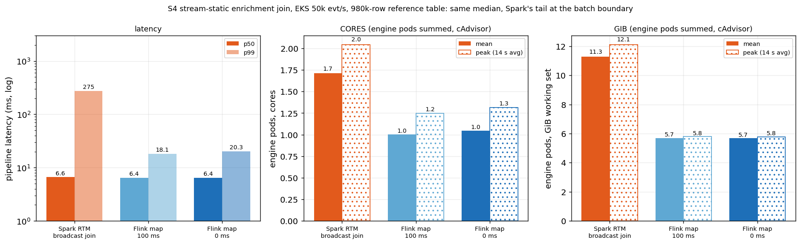

- **Median: a tie** at ~6.5 ms. Neither engine is near saturation.
- **Tail: ~13.5x** (275 ms vs 20.3 ms at Flink's 0 ms, 15x vs its 100 ms default). In the local
  smoke, all of Spark's slow records fell in the second of the RTM batch boundary, where the
  long-running tasks restart and the broadcast join is re-planned. On EKS I've inferred that,
  not separately measured it. It's the same pattern as stateless RTM before 4.3, only smaller:
  no state to commit, but the boundary still costs.
- **Resources:** Spark uses ~1.7x the CPU (1.7 vs 1.0 cores) and 2.0x the working set
  (11.3 vs 5.7 GiB; the broadcast table lives on the heap, 9.0 vs 3.2 GiB peak). Flink's
  checkpoints are trivial (no state, ~0 MB).
- **Flink 100 ms vs 0 ms:** the same median, as expected for a fully chained job; the p99s
  are within 2 ms (18 vs 20 ms).

**Correctness.** With the start-gating fix (`1f06ad2`, the load starts only after the driver
logs the started query) in place, every S4 run emitted the inner-join count for its
input: on identical input (93,248,434 events) Spark, vendor-tuned Spark and Flink emitted
91,382,100-91,382,101 joined records. Without the gate, one Spark run came out 302,229 records short, because Spark resolves `startingOffsets=latest` only when the query starts,
which for S4 is after the driver has loaded and counted the reference table.

### S5: stream-stream interval join (what leaving RTM costs)

Orders joined to payments on `order_id` where the payment arrives within 10 s of the order.
OSS RTM 4.3 rejects stream-stream joins (`OPERATOR_OR_SINK_NOT_IN_ALLOWLIST`), so the Spark
side runs **micro-batch**: this measures what you give up by leaving RTM for this workload,
not RTM vs Flink. Spark: watermarked join with a time-range condition. Flink:
`keyBy(order_id).intervalJoin(...).between(0, 10 s)`.

**S5 runs below saturation:** `S5_RATE=1000` per producer pod, ~8k orders/s plus ~6.8k
payments/s (~15k records/s), and one step up at 2000 per pod (~30k records/s). At ~50k records/s
both engines saturate (below).

S5, pipeline p50 / p99, geomean across runs.

| arm | 1000/pod: p50 | p99 | out pairs/s | CPU mean / peak | 2000/pod: p50 | p99 | CPU throttled |
|---|--:|--:|--:|--:|--:|--:|--:|
| Spark micro-batch, default trigger | 3.3 s | 5.5 s | 6.4k | 2.4 / 3.6 | 4.8 s | 8.4 s | 30% |
| Spark micro-batch, 1 s trigger | 3.4 s | 5.7 s | 6.4k | 2.4 / 3.6 | 5.3 s | 10.1 s | 34% |
| Flink intervalJoin, 100 ms | 61 ms | **0.65 s** | 6.4k | 2.8 / 3.7 | 88 ms | 3.9 s | 52% |
| Flink intervalJoin, 0 ms | 7.5 ms | **0.69 s** | 6.4k | 3.9 / 4.8 | 33 ms | 3.5 s | 62% |

*CPU and throttling: engine pods, kubelet cAdvisor.*

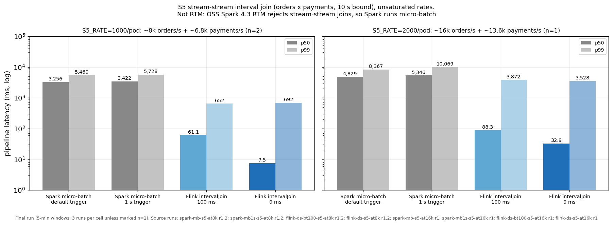

- **Below saturation, Flink's interval join wins at the median and the tail.** At ~15k
  records/s it is 7.5-61 ms at p50 and 0.65-0.69 s at p99, against 3.3-3.4 s and 5.5-5.7 s for
  Spark micro-batch. Every arm keeps up with the ~6.4k pairs/s offered, and all four emit exactly
  the same pairs for the same input (2,432,233).
- **Spark's median is the batch.** Micro-batch with a state-store commit per batch sets a
  seconds-scale floor; the 1 s trigger doesn't lower it.
- **At 2000/pod Flink is near its limit.** Its p99 climbs to 3.5-3.9 s with the workers 52-62%
  throttled, still ~2-3x lower than Spark micro-batch's 8.4-10.1 s.
- **At ~50k records/s Spark's tail is better, but only because both engines saturate.** Flink
  emitted ~15.5-16.4k pairs/s against ~21.8k
  offered, its 11-27 s aligned checkpoints stalled the join, and its p99 reached 73-85 s,
  while Spark micro-batch kept pace with a p99 of ~17 s. That is a saturation result, not a
  latency head-to-head.

---

## Scaling under changing load

Everything above runs at a fixed rate on a fixed cluster. Real traffic moves. So I stepped S1 (the windowed aggregation) from **50k to 100k and back to
50k evt/s**. Engine nodes
(m5.2xlarge) were managed by Cluster Autoscaler, 1 to 5 nodes, and every worker pod was the same
3 CPU / 6 GiB as elsewhere in this post. Topics had 24 partitions and Flink's max parallelism
was 120, so there was room to scale.

| arm | how it scales |
|---|---|
| Flink static peak | sized for 100k from the start: parallelism 12, 4 TaskManagers |
| Flink operator autoscaler | starts at parallelism 6 (2 TaskManagers), vertices allowed 3-12; adaptive scheduler, in-place rescale |
| Flink Reactive + HPA | standalone application mode, `scheduler-mode: reactive`; a Kubernetes HPA adds or removes TaskManagers on CPU (2-4) and the job rescales to whatever slots exist |
| Spark RTM static peak | sized for 100k: 4 executors |
| Spark RTM manual restart | the runner stops the query at each step and restarts it, from the same checkpoint, on the low (2 executors) or peak (4 executors) shape |
| Spark micro-batch + dynamic allocation | 1-4 executors, shuffle tracking. **Not RTM**: shown as "the Spark option that does scale" |

Per arm, phases 1/2/3 = 50k/100k/50k. "Steady" = seconds from the step until
every later 60 s window has p99 < 2 s ("-" = never). Node-hours are relative to the same
engine's static-peak arm.

| arm | steady s, 1/2/3 | p99, 1/2/3 | worst 1 s p99 at 100k | longest output stall | node-hours vs peak | lost / overcounted windows |
|---|---|---|---|---|--:|---|
| Flink static peak | 59 / 0 / 0 | 0.45 / 1.1 / 0.41 s | 2.2 s | 4 s (start) | 1.0 | 0 / 0 |
| Flink autoscaler | ~90 / 979, never / 559-690 | ~1.6 / ~2.75 / ~1.8 s | 7.5-8.2 s | 1-3 s per rescale | **0.5** | 0 / 0 |
| Flink Reactive + HPA | 389-460 / ~290 / 0 | ~13 / ~4.2 / ~0.57 s | 12.2-13.1 s | 3-4 s per rescale, then catch-up | 0.95 | 0 / 0 |
| Spark RTM static peak | - / - / - | 71 / 6.5 / 4.4 s | 9.6 s | 59 s (start, see caveat) | 1.0 | 0 / 0 |
| Spark RTM manual restart | - / - / - | ~215 / ~170 / ~212 s | ~225 s | 138-155 s per restart | ~0.8 | 0 / 0 |
| Spark micro-batch + DA | - / - / - | 12-14 / 20-31 / 6.2 s | 31-45 s | 22-23 s | 0.73 | 0 / 0 (lags at the end, below) |

*Truth check on a 1% user sample: ~1.3M settled windows per load profile.*

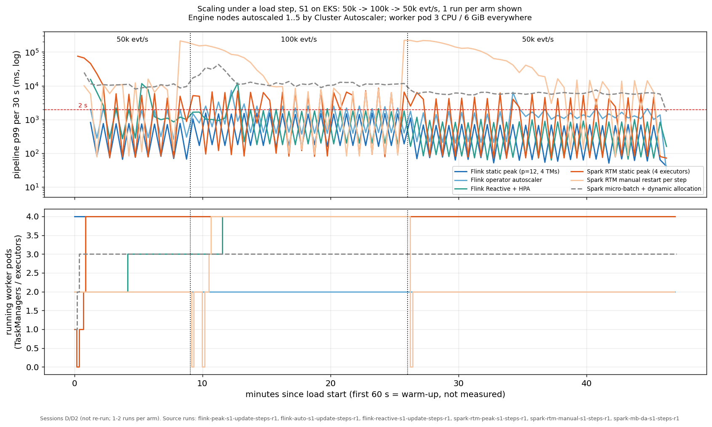

*p99 per 30 s and running worker pods.*

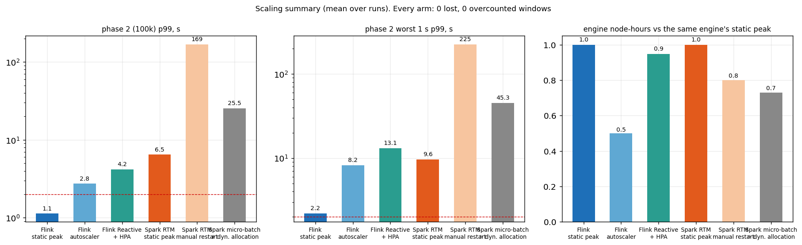

*Mean over runs.*

**Correctness held everywhere.** Every arm, including every restart and rescale, had 0 lost
and 0 overcounted windows. What changes is latency, stalls and cost.

**Flink static peak is the only arm that kept p99 under 2 s through the step** (1.1 s at
100k). It costs twice the node-hours of the autoscaler arm, because it holds 4 TaskManagers for
the whole run, including the 50k phases where it doesn't need them.

**The Flink autoscaler scaled down, even at 100k, on this profile.** It never added a
TaskManager. Instead it
moved the source from parallelism 6 to 3 and the window operator from 6 to 4, kept 2 engine
nodes, and used **half the node-hours**. The cost was latency: p99 ~2.75 s at 100k with 7-8 s
spikes, and it didn't reliably reach the steady-state bar in that phase (once in two
attempts). Why it chose
that:

- **It sizes by busy time, not latency.** The operator autoscaler reads each vertex's busy time
  (how much of each second its subtasks spend processing) and the observed rates, then targets
  70% utilisation. From that it estimated the window vertex could handle ~130-140k records/s at
  parallelism 6 (its ScalingReport: "Processing capacity 139837 -> 93225, target data rate
  49741" for 6 -> 4). Against a ~100k target that's over-provisioned, so by its own model scaling
  down was right.
- **Its model doesn't see checkpoint stalls.** What it doesn't model is the tail. At parallelism
  3-4 each checkpoint takes longer (3.1 s on average vs 2.0 s at 12), and those are exactly
  the 7-8 s spikes in the timeline. Busy time measures throughput headroom, not p99.
- **The default windows are slow, so I shortened them.** The defaults are a 5-minute
  stabilisation interval, a 15-minute metrics window and a **1-hour** scale-down interval. With
  those, no decision would land inside one load phase, so I used 2 min / 4 min / 6 min.
  That makes the arm more reactive than a default deployment, not less. With the defaults it
  would most likely have done nothing during the step.
- **Rescales are cheap.** With the adaptive scheduler, each in-place rescale stalled output for
  1-3 s, restoring from the last checkpoint.
- **It does scale up, from a different start.** The scale-down above comes from where it
  started. Its capacity estimate was learned during the 50k phase, at parallelism 6, and that
  estimate was already above 100k. Started directly at 100k (the scale-in profile below), it
  scaled up within 8.8 min (sources 6 -> 12, window 6 -> 8). So "the autoscaler won't scale up"
  is wrong; "the autoscaler sizes from what it has measured, and a low-load start can leave it
  over-confident" is right.

The lesson for Flink: the autoscaler optimises cost at a utilisation target. If you have a p99
SLO, you need a static floor (or a lower utilisation target) on top of it.

**Flink Reactive + HPA works, but every rescale is a restart.** The JobManager-side autoscaler is
out of the loop here: a Kubernetes HPA watches TaskManager CPU and adds or removes pods, and
Reactive Mode restarts the job at whatever parallelism the new slot count allows. The HPA
consistently added a third TaskManager already in the 50k phase (CPU above its 70% target on two
3-core pods), then a fourth about 80 s after the 100k step, so the job went 6 -> 9 -> 12. Each
step is a full job restart from the last checkpoint: a **10-20 s p99 spike** and then a
catch-up, which is what phases 1 and 2 pay for (p99 ~13 s and ~4.2 s). Once at 12 it ran
phase 3 at **~0.57 s p99**, the best of any autoscaled arm. But **it never scaled back in** on
this profile: CPU per TaskManager at 50k stayed above what a 3-TaskManager shape would need, so
the HPA kept 4 through the final 50k phase. Net: **~0.95x the node-hours of static peak, with worse
latency in the first two phases.**

**Scale-in (100k -> 25k).** To check whether either Flink autoscaler gives capacity back, a
second profile starts at 100k and drops to 25k.

Phases 1/2 = 100k/25k.

| arm | steady s, 1/2 | p99, 1/2 | worst 1 s p99, 1/2 | path | engine nodes, mean | lost / overcounted |
|---|---|---|---|---|--:|---|
| Flink autoscaler | 589 / 759 | 13.5 / **1.45 s** | 20.9 / 4.7 s | parallelism 6 -> 12,8 (up, +8.8 min) -> 6 -> 3 (in) | 3.1 | 0 / 0 |
| Flink Reactive + HPA | 640 / 380 | 17.5 / **29.7 s** | 22.0 / **46.0 s** | 6 -> 9 -> 12 -> 9; HPA 2 -> 4 -> 3 | 3.4 | 0 / 0 |

*~1.0M settled windows checked per load profile.*

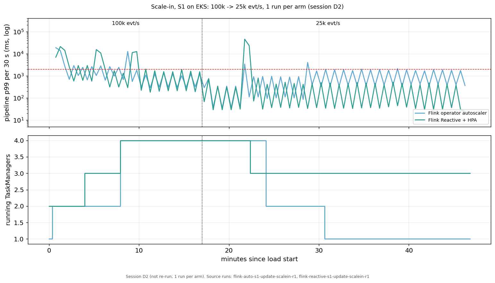

*p99 per 30 s and running TaskManagers.*

- **The operator autoscaler scales in cleanly.** At 25k it stepped down twice (to 6 at +4.9 min,
  to 3 at +11.9 min), each an in-place rescale with a short spike, and settled at a p99 of
  1.45 s at 25k on one TaskManager.
- **Reactive scaled in one step, and that step was the worst event measured.** The HPA
  removed one TaskManager (4 -> 3) at +5.4 min. The restart to parallelism 9 pushed the 25k
  phase to **p99 29.7 s, with a 46 s spike, and took ~6 min to recover.** Removing capacity
  costs a full restart while the job is losing slots at the same time.
- Both emitted 0.5-1.7M more records than input: the at-least-once sink re-emits after every
  restart or rescale, as in the recovery section.

**Spark RTM can't autoscale.** Stateful RTM rejects dynamic allocation at runtime. The query
fails in `org.apache.spark.scheduler.DAGScheduler` (spark-core 4.3.0) with *"Dynamic allocation
is not supported for a job that uses a pipelined shuffle dependency: a pipelined stage group
must be co-scheduled against a known cluster size"*. I reproduced that locally
(`results/local-scaling-smoke/spark-da-rtm.txt`). Stateless RTM isn't blocked by that check,
but it wouldn't help either: RTM maps Kafka partitions 1:1 to long-running tasks, so extra
executors get no work. That leaves two options:

- **Static peak:** once all 4 executors were up it carried 100k with p99 6.5 s, but every 60 s
  batch boundary still spiked to 2-14 s, so no Spark RTM arm ever met the steady-state bar, at
  any load.
- **Manual restart at each step:** each stop-resubmit-start took **25-320 s**, and the backlog
  built during it took 5-10 minutes to drain at a p99 of ~200 s. Restarting to scale was far
  more disruptive than the load step itself. It saved ~20% of node-hours.

**Spark micro-batch with dynamic allocation scales, but didn't keep up.** Dynamic allocation
worked mechanically: 2 executors went to 3. It never reached 4, and the job never caught up:
p99 6-31 s, and at the end of the measurement **about 15% of the input (27-28M records) was still
unprocessed**. The settled windows it had output were all correct, so that's lag, not loss.
It used 0.73x the node-hours of RTM static peak, mostly by not finishing the work.

**Caveats:**

- **Cost and node-hour figures are estimates rebuilt from logs** (10 s node samples over each
  load, the runner log and node listings), not billing data: the node groups were deleted before
  billing could be read back.
- **Spark micro-batch + dynamic allocation didn't drain:** about 15% of the input was still
  unprocessed at the end of each measurement. That's lag, not loss (0 lost / 0 overcounted on the settled
  windows), and it flatters that arm's node-hours.
- **The Flink autoscaler scaled down, not up, during the base profile's 100k step,** because its
  50k start gave it a high capacity estimate. Its scale-up is only shown by the scale-in profile,
  which starts at 100k.
- **Spark RTM static peak, phase 1, is skewed by node scale-up.** Its executors came up one
  at a time as Cluster Autoscaler added nodes (0 -> 1 -> 2 -> 4), so the first minutes ran short
  of slots: the 71 s p99 and 59 s stall belong to cluster start-up, not to RTM at 50k. On the
  fixed 2-node shape (the 2x2 above), Spark RTM S1 p99 is ~7.5 s at 50k.
- **Two load profiles, S1 only.**
- **The Flink autoscaler used shortened windows** (2 / 4 / 6 min), not the defaults; Reactive's
  HPA used a 5-minute scale-down window.

---

## Resources and cost

Latency is half the story. The other half is what each engine burns to get it, and what that
costs.

### How to read these numbers

- **Source:** an in-cluster sampler. It scrapes the kubelet's cAdvisor endpoint
  every 2 s for every engine container (CPU seconds, working set, RSS, CFS throttling), reads JVM
  heap every 10 s (`jcmd GC.heap_info` for Spark, Flink's REST metrics). After each run it lists
  the run's S3 checkpoint prefix.
- **CPU resolution is ~14 s, not 2 s.** The kubelet only refreshes container stats about every
  14 s (measured), so CPU is a rate between counter updates. "Peak" means the highest ~14 s
  average, not the true instantaneous peak.
- **Usage, not limits.** Every engine got the same requests and limits (two 3-core / 6 GiB
  worker pods plus a coordinator). The numbers below are what the pods actually used.
- **Engine pods only,** summed (coordinator + 2 workers). Operator pods, Kafka and producers are
  excluded.
- **Per 10k events/s** means divided by the *input* rate: 100k evt/s for stateless, 50k evt/s for
  stateful.
- **Memory is JVM-sized.** Both engines' JVMs grow to their configured heap and RocksDB caches,
  so working set reflects configuration as much as need.
- **No separate state-memory number.** Flink's RocksDB metrics, summed per operator, count its
  shared block cache more than once, so memory here is working set (which includes RocksDB's
  native memory) and JVM heap only.
- **Checkpoint data per hour.** A checkpoint prefix keeps growing on Spark, so bytes and objects
  are the end-of-run prefix divided by the run's length (measurement + warm-up).

### Per workload and arm

Engine pods summed: mean over runs, peaks the max over runs.

| workload | arm | p99 ms | CPU cores, mean / peak | working set GiB, mean / peak | CPU throttled % | JVM heap peak GiB | checkpoint MB/h | S3 PUTs/h (lower bound) |
|---|---|--:|--:|--:|--:|--:|--:|--:|
| stateless | Flink DataStream | 27 | 1.06 / 1.21 | 5.5 / 5.6 | 0.0 | 3.3 | 0 | 2 |
| stateless | Spark RTM Java | 30 | 1.74 / 2.90 | 8.1 / 8.2 | - (no limit) | 6.3 | 0 | 130 |
| S1 | Flink tuned (0 ms) | 1,575 | 3.54 / 4.31 | 7.1 / 8.4 | 3.5 | 3.2 | 402 | 106 |
| S1 | Flink default (100 ms) | 1,321 | 1.94 / 2.79 | 6.9 / 7.9 | 2.9 | 3.2 | 344 | 106 |
| S1 | Spark RTM default (50 ms) | 7,481 | 3.86 / 6.17 | 9.5 / 10.1 | 16.7 | 6.2 | 6,107 | 1,096 |
| S1 | Spark RTM vendor-tuned | 4,454 | 3.97 / 5.56 | 9.5 / 10.1 | 12.1 | 6.5 | 6,440 | 1,160 |
| S1 | Spark RTM 1 ms (did not hold rate; 5-minute windows) | 16,746 | 5.90 / 6.60 | 9.2 / 9.5 | 94.0 | 5.9 | 7,135 | 1,865 |
| S2 | Flink tuned (0 ms) | 1,706 | 3.71 / 4.56 | 6.2 / 6.7 | 1.7 | 3.4 | 443 | 106 |
| S2 | Flink default (100 ms) | 1,670 | 2.03 / 2.83 | 6.2 / 6.7 | 1.4 | 3.2 | 441 | 106 |
| S2 | Spark RTM default (50 ms) | 7,693 | 3.37 / 5.72 | 9.3 / 9.8 | 12.2 | 6.5 | 5,138 | 1,097 |
| S2 | Spark RTM vendor-tuned | 4,334 | 3.58 / 4.69 | 9.2 / 9.6 | 9.0 | 6.5 | 5,315 | 1,143 |
| S2 | Spark RTM 1 ms (5-minute windows) | 10,492 | 5.89 / 6.58 | 9.1 / 9.5 | 93.4 | 6.2 | 5,705 | 1,837 |
| S3 | Flink tuned (0 ms) | 4,281 | 4.93 / 5.59 | 7.4 / 8.6 | 5.6 | 3.3 | 548 | 257 |
| S3 | Flink default (100 ms) | 4,187 | 3.44 / 4.49 | 7.4 / 8.7 | 3.9 | 3.3 | 536 | 257 |
| S3 | Spark RTM default (did not hold rate) | backlog | 5.91 / 6.88 | 10.2 / 11.1 | 96.4 | 6.8 | 20,817 | 606 |
| S3 | Spark RTM 1 ms (did not hold rate; 5-minute windows) | backlog | 5.98 / 6.78 | 9.2 / 9.6 | 95.2 | 6.2 | 10,593 | 1,916 |
| S3 | Spark RTM vendor-tuned (did not hold rate) | backlog | 5.92 / 6.83 | 10.5 / 11.6 | 94.4 | 6.9 | 19,873 | 699 |

*Checkpoint MB/h and S3 PUTs/h are the bytes and objects under a run's checkpoint prefix at the
end of the run, per hour of run time (objects = a PUT lower bound; GET and LIST weren't counted).
Full table with cost columns: `post/charts/cost_table.md`.*

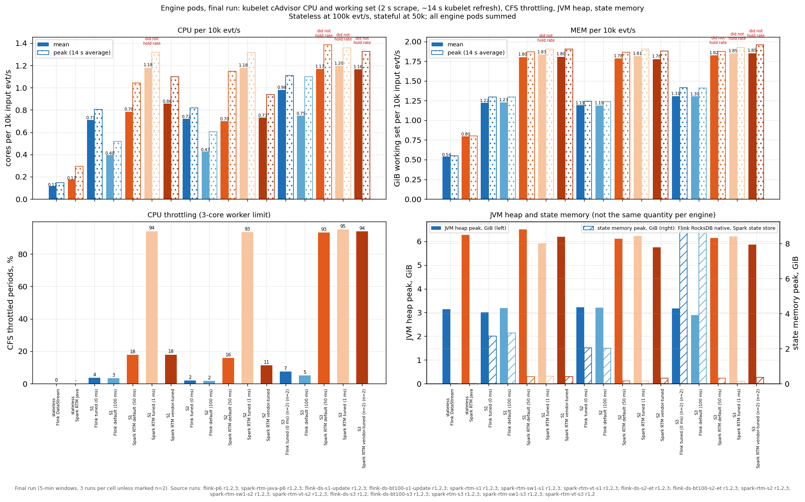

What this shows:

- **Mean CPU is close; peaks and throttling are not.** On S1/S2, tuned Flink and default Spark
  use about the same average CPU (3.4-3.9 cores, 0.67-0.77 per 10k evt/s). But Spark's peak is
  31-70% above its mean (4.7-6.2 cores), against 22-23% for Flink, and Spark's executors spend
  12-17% of CFS periods throttled at their 3-core limit, against 2-4% for Flink. Spark's CPU
  comes in bursts that hit the limit.
- **Flink's default is the cheap arm.** At a 100 ms buffer timeout, Flink uses ~45% less CPU
  than at 0 ms (1.9 vs 3.5 cores on S1, 2.0 vs 3.7 on S2) and still has a lower p99 (1.3-1.7 s)
  than every Spark arm (best: 4.3-4.5 s). Flink's 0 ms buys the median; it costs ~1.6-1.7 cores
  at 50k.
- **Memory: Flink runs on 0.67-0.75 of Spark's working set** (6.2-7.1 vs 9.3-9.5 GiB on S1/S2,
  5.5 vs 8.1 GiB stateless). The difference is mostly heap: Flink's JVM heap peaks at 3.2-3.4 GiB,
  Spark's at 6.2-6.5 GiB. Flink's RocksDB state lives off-heap, inside the same working set.
- **Spark at 1 ms, and Spark on S3, are pinned at the ceiling.** Workers are throttled 93-96% of
  the time and the jobs fall behind, so those cells show the cost of *failing* to hold the rate.
- **Spark writes 12-15x more checkpoint data.** On S1/S2, Spark's checkpoint prefix grows by
  5.1-6.1 GB/h in ~1,100 objects/h at default settings; tuned Flink's by 0.40-0.44 GB/h in
  ~106.

### CPU over time: where the bursts come from

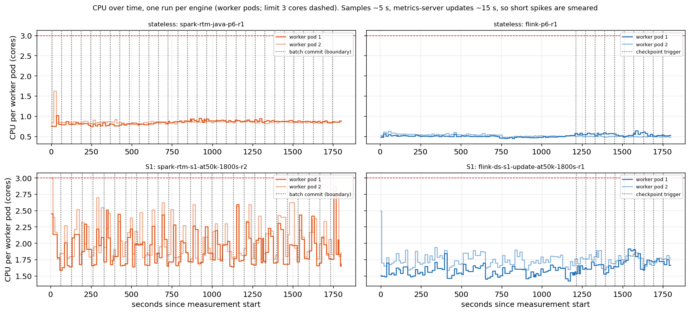

*Worker-pod CPU per sample from `kubectl top` (kept alongside the cAdvisor sampler; the raw 2 s
cAdvisor series isn't committed). Dotted lines: Spark batch
boundaries (driver commit log; S3 offset-file timestamps for the stateless run), Flink
checkpoint triggers (the last 20 the REST history keeps). The caption on the chart names the run
shown for each panel.*

Stateful Spark (bottom left) is a sawtooth: CPU climbs 10-30 s after each batch boundary, as the
executors drain the ~300k records that queued during the synchronous commit, then falls back.
Stateful Flink (bottom right) is flat; at this sampling resolution, its checkpoint uploads
don't show as bursts. Stateless, both engines are flat and well under one core per pod. A
burst shorter than ~14-15 s is invisible here, with either sampler.

### What it costs

**Equal hardware means equal dollars per hour.** Both engines ran on the same two m5.2xlarge
engine nodes at **$0.384/h each, on-demand, Linux, us-east-1** (per the
[AWS on-demand pricing page](https://aws.amazon.com/ec2/pricing/on-demand/); cross-checked on
[instances.vantage.sh](https://instances.vantage.sh/aws/ec2/m5.2xlarge)).
At 50k evt/s that's $0.768/h for 180M events/h, **$0.0043 per million events for both
engines.** If you size the cluster the way I did, the engine choice doesn't change the bill.

What changes is **headroom**: how much of that hardware each engine leaves free while holding
50k evt/s at its latency. Two ways to put a price on it:

**The last two columns are EXTRAPOLATED.** One m5.2xlarge = 8 vCPU / 32 GiB.

| workload | arm | p99 | $ per M events, CPU actually used | node-equivalents at peak CPU / peak WS (min nodes) | EXTRAPOLATED evt/s per node | EXTRAPOLATED $ per M events |
|---|---|--:|--:|--:|--:|--:|
| stateless | Flink DataStream | 27 ms | 0.00014 | 0.17 (1) | ~661,000 | 0.00016 |
| stateless | Spark RTM Java | 30 ms | 0.00023 | 0.36 (1) | ~276,000 | 0.00039 |
| S1 | Flink tuned (0 ms) | 1.6 s | 0.00094 | 0.54 (1) | ~93,000 | 0.00115 |
| S1 | Flink default (100 ms) | 1.3 s | 0.00052 | 0.35 (1) | ~143,000 | 0.00074 |
| S1 | Spark RTM default | 7.5 s | 0.00103 | 0.77 (1) | ~65,000 | 0.00164 |
| S1 | Spark RTM vendor-tuned | 4.5 s | 0.00106 | 0.70 (1) | ~72,000 | 0.00148 |
| S2 | Flink tuned (0 ms) | 1.7 s | 0.00099 | 0.57 (1) | ~88,000 | 0.00122 |
| S2 | Flink default (100 ms) | 1.7 s | 0.00054 | 0.35 (1) | ~141,000 | 0.00076 |
| S2 | Spark RTM default | 7.7 s | 0.00090 | 0.71 (1) | ~70,000 | 0.00152 |
| S2 | Spark RTM vendor-tuned | 4.3 s | 0.00096 | 0.59 (1) | ~85,000 | 0.00125 |
| S3 | Flink tuned (0 ms) | 4.3 s | 0.00131 | 0.70 (1) | ~72,000 | 0.00149 |
| S3 | Flink default (100 ms) | 4.2 s | 0.00092 | 0.56 (1) | ~89,000 | 0.00120 |
| S3 | Spark RTM (any arm) | backlog | n/a | n/a (did not hold 50k on 6 cores) | n/a | n/a |

*How each column is computed (`bench/make_post_charts.py`, `cost_rows`):*
- *$ per M events, CPU used* = mean engine cores × ($0.384 / 8 vCPU) ÷ millions of events per
  hour. It prices only the CPU each engine consumed.
- *Node-equivalents* = the larger of peak cores ÷ 8 (a ~14 s average) and peak working set
  ÷ 32 GiB. *Min nodes* rounds it up. Every cell that held its rate fits on one node.
- *EXTRAPOLATED evt/s per node* = measured rate × 8 ÷ peak cores, i.e. **linear scaling to a
  full node**, assuming CPU is the bottleneck and latency holds. Spark's 1 ms arm shows that
  scaling is not always linear, so read these as an upper bound. **No capacity probe was run;
  these per-node numbers are an extrapolation, not a measurement.**
- *EXTRAPOLATED $ per M events* = $0.384/h ÷ that extrapolated rate.

Read across, at the measured utilisation:

- **Stateless:** Flink needs ~0.4-0.6x the CPU of Spark RTM per event (peak / mean). Both are
  tiny next to the node price: under $0.0004 per million events either way.
- **S1/S2:** at its best latency (0 ms), Flink uses about the same mean CPU per event as default
  Spark, and its extrapolated cost is 2-22% below vendor-tuned Spark, with a 2.5-2.8x lower p99.
  At Flink's default (100 ms) it's ~40-55% cheaper than any Spark arm that held the rate, *and*
  still has the lower p99.
- **S3:** only Flink's numbers exist. Spark didn't hold 50k evt/s on these 6 cores, so its cost
  per event at that rate is undefined, not just higher.
- **Caveat on "headroom":** the pool has slack, but each pod doesn't. Spark executors are
  throttled 12-17% of the time even at default settings, so the free node CPU only helps if you
  resize the pods, which nothing here measured.

**Checkpoint storage and S3 requests.** Small on both engines next to compute. Flink uploads a
median of 61-87 MiB per S1/S2/S3 checkpoint (incremental) against 134-184 MiB of retained state:
~3.6-5.1 GiB/h written, while its prefix grows by only 0.34-0.55 GB/h. Spark's prefix grows by
5.1-6.4 GB/h on S1/S2 at default and vendor-tuned settings (12-16x tuned
Flink's) and ~20 GB/h on S3. The S3 PUT lower bound is
~1,100-1,160 objects/h for Spark on S1/S2 and 106-257/h for Flink: under $0.01 per hour at S3
Standard request prices for either engine. Standing storage is a fraction of a cent per month, and in-region
transfer to S3 is free. GET and LIST requests weren't counted.

---

## What RTM can't do yet (feature gaps)

These are not head-to-head numbers, because only one engine can run them.

| capability | Flink 2.3 | OSS Spark 4.3 RTM |
|---|---|---|
| stream-stream joins | yes (interval, regular, temporal) | no (micro-batch only) |
| CEP / pattern matching | yes (FlinkCEP, `MATCH_RECOGNIZE`) | no |
| broadcast state (dynamic rules / config stream) | yes | no; only broadcast of a *static* table |
| session windows | yes | no |
| arbitrary stateful processing from Python | yes (PyFlink keyed state + timers) | no (PySpark `transformWithState` not in RTM) |
| `flatMapGroupsWithState` | n/a | no (use Java/Scala `transformWithState`) |
| exactly-once Kafka sink | yes (transactional) | no (at-least-once) |
| async state checkpointing | yes (always) | no (DBR-only) |
| event-time timers firing mid-batch | yes | no: RTM's watermark is fixed per batch, so they fire at batch boundaries |
| output modes | append, upsert, retract | update only |

---

## Limits of this benchmark

- **Run-to-run spread.** A Spark p99 depends on a handful of 60 s batch boundaries, so a single
  slow boundary can move it. The ranges in brackets show how far.
- **Capacity and cost per node are extrapolated,** not measured: no capacity probe was run.
- **Recovery is one scenario:** S1, one worker killed (0 lost, 0 overcounted every time). Spark
  didn't get back to full rate within the measurement, so its recovery time is a lower bound,
  not a number.
- **S5's EKS correctness is cross-engine agreement,** not a ground-truth diff (all four arms
  emitted the same 2,432,233 pairs); the local replay is the ground truth.
- **One region, one instance type,** RocksDB on both sides, aligned checkpoints. The Flink
  tuning that targets checkpoint tails (changelog, unaligned, ForSt) is deferred to Part 2.
- **The Flink S2 tail is not fully explained.** Event-time cleanup registers one timer per
  event, and the likely cause of the 1.7 s p99 is those timers firing in bursts on watermark
  advances, but I haven't profiled it.
- **Stateless placement differs from the original post.** Here the engines run on 2 dedicated
  nodes; the original post used one shared 6-node pool with Kafka and the producers. Keep that
  in mind when comparing against the published 4.1.2 / 2.2.0 numbers.
- **Resource data has ~14 s CPU resolution** (the kubelet's refresh interval), and the
  per-node cost figures are linear extrapolations, not measured capacity. S3 GET and LIST
  requests weren't counted.
- **OSS only.** DBR's RTM (async state checkpointing, stream-stream joins) is a different
  product and is not tested.

---

## So, which one?

For **stateless** pipelines, Spark 4.3 RTM is now a real low-latency engine at production
durability: ~6 ms median, ~30 ms p99 with S3 checkpoints, from Java, Scala or Python. At the
tail it's now roughly a tie with Flink (27.4 vs 30.3 ms), and Flink is still leaner on memory;
the 20x gap from the original post is gone. If you're on Spark and your job is stateless, RTM is
a good choice today.

For **stateful** pipelines, tuned Flink wins every workload I could run on both: about 1.9x lower
median and 2.5-2.8x lower p99 than the best-tuned OSS RTM, a recovery that's back in about a
minute while Spark's hadn't recovered within the measurement, and the timer-heavy session
workload that RTM can't sustain at 50k evt/s. The cause is one design choice: OSS stateful RTM still commits synchronously. When
that goes async in OSS, I'd expect stateful RTM to follow the same path stateless RTM just did,
and I'll revisit this.

For **changing load** (S1, 50k -> 100k -> 50k), both engines
kept state exact through every rescale and restart, but only static Flink sized for the peak
kept p99 under 2 s. Flink's operator autoscaler halved the node-hours by scaling *down*, at
~2.75 s p99 with 7-8 s spikes, because its 50k start told it the job had headroom; started at
100k, it scaled up, and it scaled back in cleanly at 25k. Flink Reactive + HPA scales on CPU, but
each rescale is a restart (10-20 s spikes), it never gave capacity back on the base profile
(~0.95x static peak's node-hours), and its one scale-in step was the worst event measured (p99
29.7 s). OSS Spark RTM has no autoscaling path at all: stateful RTM rejects dynamic allocation,
and a manual restart stalls 25-320 s.

For **joins**, the stream-static enrichment RTM supports ties Flink at the median (~6.5 ms) but
carries a ~13.5x tail (275 vs 20 ms), ~1.7x the CPU and 2.0x the working set. For the stream-stream join
RTM doesn't support, Spark micro-batch is the fallback, and below saturation Flink's interval join
beats it at the median and the tail (p99 0.65-0.69 s vs 5.5-5.7 s).

And for the workloads RTM doesn't run yet (stream-stream joins, CEP, broadcast state, session
windows), Flink is the only option in this comparison.

---

## Appendix A: run it yourself

```bash
# EKS stateless p6 matrix (Spark 4.3.0 / Flink 2.3.0)
eks/04b_run_p6.sh <engine>
# EKS stateful matrix, in-cluster runner (one cluster per plan set F30A..F30D)
PLAN_SET=F30A BUDGET_S=34200 RUN_EST_S=1260 SELF_TEARDOWN=1 eks/stateful/deploy_runner.sh
# Tables and charts
python3 bench/analyze_final_run.py results/final30 --runs 2   # -> results/final30/cells.md, cells.json
python bench/make_post_charts.py    # -> post/charts/*.png + numbers.json
```

## Appendix B: reproduction

Everything below is in
[the repo](https://github.com/fmorillo7694/spark-rtm-vs-flink).

**1. Deploy the cluster.**

| step | script | what it does |
|---|---|---|
| cluster | `eks/01_create_cluster.sh` (`eks/cluster.yaml`) | EKS 1.36, 6 × m5.2xlarge: 2 tainted engine nodes + 4 `bench-ng` nodes for Kafka, producers, consumer and the runner |
| platform | `eks/02_install.sh` | Strimzi Kafka 4.1 (3-broker KRaft, RF 3), the Flink and Spark Kubernetes operators |
| checkpoint storage | `eks/02b_irsa_s3.sh` | S3 access for the engine pods' checkpoints (IRSA) |
| images | `eks/03_build_push_images.sh` | engine images (`apache/spark:4.3.0`, `flink:2.3.0`, PyFlink) with the benchmark jobs, and the load image (datagen, consumer, in-cluster runner) to ECR |
| teardown | `eks/99_teardown.sh` | deletes the cluster; leaves the S3 checkpoint bucket and ECR repos in place |

**2. Run the workloads.**

| what | how |
|---|---|
| 30-minute cells (stateless, S1-S4) | four clusters, one plan set each: `PLAN_SET=F30A` (S1), `F30B` (S2), `F30C` (S3), `F30D` (S4), plus three stateless cells, via `eks/stateful/deploy_runner.sh` with `RUN_EST_S=1260` and `BUDGET_S=34200` (F30C: `35900`); the in-cluster runner is `eks/stateful/run_matrix_incluster.sh` |
| 5-minute cells (Spark 1 ms, async-off, recovery, S5, S4 at 100k, interval sweep, smaller results) and scaling | the other plan sets of the same runner (`PLAN_SET=FA` / `FB`, and the scaling profiles); stateless also via `eks/04b_run_p6.sh <engine>` |
| runner budget and teardown | the runner starts no run that doesn't fit in `BUDGET_S`, and scales both nodegroups to 0 when it ends; `eks/stateful/arm_deadline.sh` arms an EventBridge deadline that deletes the nodegroups and the cluster independently of the runner |
| before launch | `eks/stateful/preflight_runner.sh`: the runner's IAM role and RBAC exist and its self-teardown calls are allowed (IAM simulation, `kubectl auth can-i`) |
| after the runner | `eks/stateful/wrapup_cluster.sh`: checks the nodegroups are at 0 and the results are complete in S3 (`eks/stateful/verify_s3_results.sh`), then deletes the cluster, disarms the deadline and verifies nothing is left |
| resource sampling | `eks/stateful/sampler.py` (kubelet cAdvisor every 2 s, JVM heap every 10 s, checkpoint bytes and objects) |
| engine settings for every arm | [`STATEFUL_CONFIG.md`](https://github.com/fmorillo7694/spark-rtm-vs-flink/blob/main/STATEFUL_CONFIG.md) |

Each run gets fresh topics and a fresh checkpoint path, and one engine runs at a time per
cluster.

**3. Analyse.**

- `bench/analyze_final_run.py` writes the per-cell summary (`cells.md`, `cells.json`) behind
  every fixed-rate table: `results/final30/` for the 30-minute cells, and alongside it under `results/` for
  the 5-minute ones; `bench/analyze_scaling_d.py` does the same for the scaling profiles.
- `bench/make_post_charts.py` writes every chart in this post plus `post/charts/numbers.json`
  and `post/charts/cost_table.md`.
- Raw per-run data (latency histograms, driver and JobManager logs, sampler output, recovery
  ground truth) is under `results/`; the 30-minute runs are in `results/final30/{a,b,c,d}/runs/`,
  one directory per cluster, with the teardown checks in `results/final30/teardown_verify.txt`.

**Cells and where they appear** (30-minute labels add `-at50k-1800s` to the stateful cells):

| block | cells | post section |
|---|---|---|
| stateless p6, 100k | `spark-rtm-java-p6`, `spark-rtm-scala-p6`, `pyspark-rtm-p6`, `flink-p6`, `flink-sql-p6`, `pyflink-p6`, `spark-rtm-syncckpt-p6` | Part 1, hero |
| S1, 50k | `spark-rtm-s1`, `spark-rtm-sw1-s1`, `spark-rtm-vt-s1`, `flink-ds-bt100-s1-update`, `flink-ds-s1-update` | 2x2, checkpoints, resources |
| S2, 50k | `spark-rtm-s2`, `spark-rtm-sw1-s2`, `spark-rtm-vt-s2`, `flink-ds-bt100-s2-et`, `flink-ds-s2-et` | 2x2, resources |
| S3, 50k | `spark-rtm-s3`, `spark-rtm-sw1-s3`, `spark-rtm-vt-s3`, `flink-ds-bt100-s3`, `flink-ds-s3` | 2x2, resources |
| S4, 50k | `spark-rtm-s4`, `spark-rtm-vt-s4`, `flink-ds-bt100-s4`, `flink-ds-s4` | Part 3 |
| S5, 1000/pod | `spark-mb-s5-at8k`, `spark-mb1s-s5-at8k`, `flink-ds-bt100-s5-at8k`, `flink-ds-s5-at8k` | Part 3 |
| S5, 2000/pod | the same four arms (`-at16k`) | Part 3 |
| recovery, 50k | `spark-rtm-s1-kill`, `flink-ds-s1-update-kill` | Recovery |
| checkpoint interval | `spark-rtm-s1-ckpt*`, `flink-ds-s1-update-ckpt*`, `spark-rtm-s2-ckpt*`, `flink-ds-s2-et-ckpt*` | Checkpoint interval |
| scaling | `*-s1-update-steps`, `*-s1-steps`, `*-s1-update-scalein` | Scaling |
